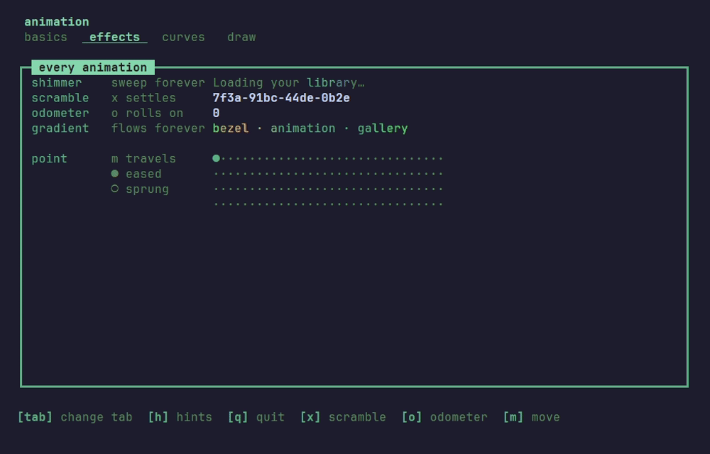
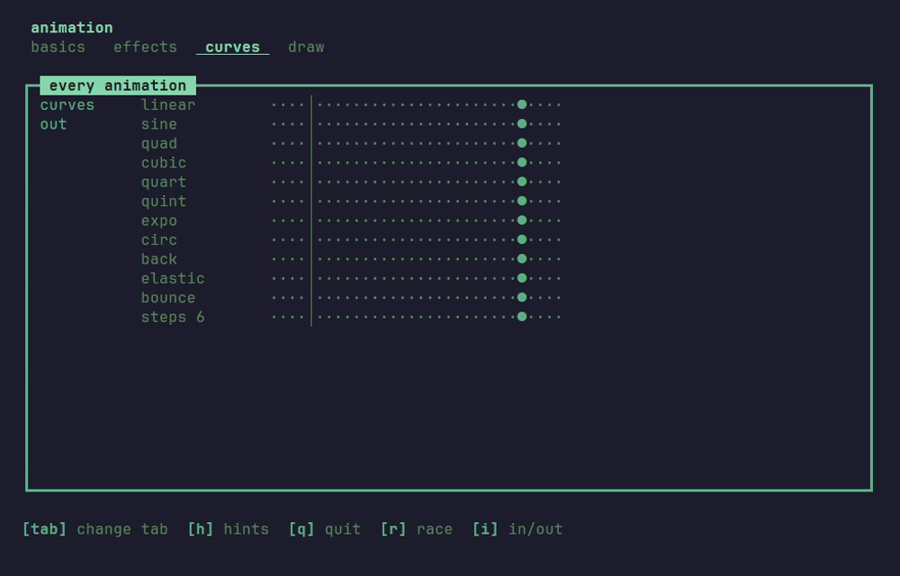

# Animation

The [`animation`](animation) package moves things on frames that arrive as messages. Every animation is a value, like the rest of bezel: it reads no clock, starts on the first frame its `Tick` delivers, takes only its own frames, and hands back a changed copy. The gallery shows every kind, a tab each:

```sh
go run ./examples/animation
```

`tab` turns the page; each tab keeps its own keys, listed at the foot of the screen.

## Two ways to drive one

**On its own frames.** Start it, hand it every `animation.FrameMsg`, and draw what it holds. It asks for its next frame until it lands, and ignores the frames of every other animation.

```go
case toggleMsg:
	m.slide = animation.New(m.height, 8, 300*time.Millisecond)
	return m, m.slide.Tick()
case animation.FrameMsg:
	var cmd tea.Cmd
	m.slide, cmd = m.slide.Update(msg)
	m.height = m.slide.Cur
	return m, cmd
```

**On one `Clock`.** A screen running several at once gives them a single chain of frames: each frame, it advances every animation to the frame's time and keeps the clock going while any of them still moves.

```go
case animation.FrameMsg:
	at, ok := m.clock.Frame(msg)
	if !ok {
		return m, nil
	}
	m.bar, _ = m.bar.Advance(at)
	m.count, _ = m.count.Advance(at)
	if m.bar.Active() || m.count.Active() {
		var cmd tea.Cmd
		m.clock, cmd = m.clock.Next()
		return m, cmd
	}
	m.clock = m.clock.Stop()
```

Start the clock, `m.clock, cmd = m.clock.Start()`, whenever one of them is set off. The gallery runs its timed rows on one clock, and the marquee, the shimmer, the gradient and the hints pane on their own frames.

## Motion


| Kind | What it moves |
|---|---|
| `Tween`, `Float` | a whole number or a fraction from one value to another: a panel's height, a bar drawn in eighths |
| `Spring` | a value after a target, with speed and inertia; a new target bends the motion instead of starting it over |
| `Fade` | a colour from one to another; `Blend` mixes two at any point |
| `Shake` | a block swaying side to side, its width kept: a refusal without words |
| `Typewriter` | text revealed a grapheme at a time |
| `Marquee` | text wider than its room, scrolled round |

Every timed one takes `WithDelay` and `WithRepeat`, `animation.Forever` for no end, and all but `Shake` take `WithYoyo`, which runs every other pass back. Delays chain one animation after another: the gallery's cascade is six tweens, each delayed a little more than the one before. A pulse is a `Fade` with `WithYoyo().WithRepeat(animation.Forever)`.

## Effects



| Kind | What it does |
|---|---|
| `Shimmer` | sweeps a glow across text, over and over: a placeholder while something loads |
| `Scramble` | shows text as noise that settles from the left; the noise depends only on the frame's time |
| `Odometer` | rolls a number digit by digit, the right-hand digits spinning most; `To` rolls on to the next value |
| `Gradient` | spreads colours round a text and lets them flow along it |
| `Move`, `Follow` | ease or spring a `Point` on both axes |

## Curves



`Linear`, `EaseIn`, `EaseOut` and `EaseInOut`, the default, and nine more, each easing in: `Sine`, `Cubic`, `Quart`, `Quint`, `Expo`, `Circ`, `Back`, `Elastic` and `Bounce`. `Out` and `InOut` turn any of them round, and `Steps(n)` moves in whole jumps:

```go
animation.New(0, 40, time.Second).WithEase(animation.Out(animation.Back))
```

Every curve starts at exactly 0 and ends at exactly 1. `Back` and `Elastic` leave that range on the way, so what they move overshoots and settles.

## Over a drawn block


An `Effect` changes a block that is already drawn. `Apply` reads the block's escape codes back into cells, turns each one and draws it again, the same size, so it works on whatever a `View` returns, a pane, a dialog or a whole screen:

```go
body := m.card.View()
if m.reveal.Active() {
	body = m.reveal.Apply(body)
}
```

| Effect | What it does |
|---|---|
| `FadeIn`, `FadeOut` | raises every cell's colours from a colour to its own, or sinks them into one |
| `Dissolve`, `Coalesce` | blanks the cells one by one, or gathers the block out of nothing |
| `SweepIn` | reveals the block behind a tinted front |
| `SlideIn`, `SlideOut` | moves the block in or out whole, from or to an edge |
| `Evolve` | grows each cell out of `░▒▓█` into its own character |
| `Explode` | throws the cells outward from the middle |
| `Expand`, `Stretch` | opens the block from its middle, or fills it from an edge in eighths of a cell |
| `HueShift`, `Saturate` | turns the colours round the wheel, or drains or deepens them |

Most take a `Pattern`, the order the cells turn in: `Sweep`, `Radial`, `Diamond`, `Diagonal`, `Checker`, `Spiral`, `Wave`, `Noise`, or any of them `Inverted`. The cells turn in a soft band, so a front reads as a front.

```go
animation.Coalesce(600 * time.Millisecond).WithPattern(animation.Radial())
```

## Between tabs

The shell plays an effect over the panes when the user changes tab, the tab strip and the legend left still. `SlideTabs` slides the new tab in from its side, and any other effect will do:

```go
shell.Config{
	// ...
	Transition: shell.SlideTabs(300 * time.Millisecond),
}
```

The shell takes the transition's frames itself and hands every other one to the app.

## Motion off

With `BEZEL_NO_MOTION` set to anything, or `TERM=dumb`, every animation is born where it would have ended and asks for no frame: tweens at their target, typed text whole, an effect that brings a block in showing it, one that takes it away leaving it gone. It is for a user who finds motion hard to follow, a slow link, or a CI log. `animation.Still()` reports it, for an app that times something of its own.
