# Examples

One small program per package, each with a recording of it running. Every GIF is a real session of the program beside it, recorded from the `.tape` next to it. Run any of them with `go run ./examples/<name>`; for everything at once, `go run ./examples/demo`.

## The frame

### Shell

Source: [`examples/shell/main.go`](examples/shell/main.go)

Two tabs and two panes. `s` sets a status that clears itself, `b` shows the busy spinner until the work is done, `tab` switches tab and `?` lists every key.


### Layout

Source: [`examples/layout/main.go`](examples/layout/main.go)

A header over two columns, each pane printing the rect it was given. `w` narrows the window below the `Collapse` limit and the side column drops out, then comes back.


### Theme

Source: [`examples/theme/main.go`](examples/theme/main.go)

Every colour role and a list drawn with it. `n` and `p` step through a few presets, and `SetTheme` swaps them on the running shell.

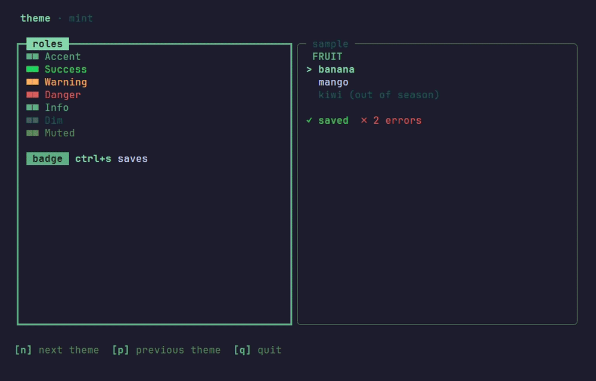

### Overlay

Source: [`examples/overlay/main.go`](examples/overlay/main.go)

The ready-made modals, one per row: an alert, a confirm that answers the app, a prompt that refuses an empty name, the help list, a pager over a command's output and a file picker. `enter` opens the one under the cursor and `esc` closes it.


### Draw

Source: [`examples/draw/main.go`](examples/draw/main.go)

One scrolling pane with a section per helper: header, tabs, breadcrumb, dividers, a card with its actions in the footer, buttons, key-value rows, wrapped and truncated text, numbered lines and the empty state.


### Legend

Source: [`examples/legend/main.go`](examples/legend/main.go)

More keys than one row holds: the ones cut are counted and `?` lists them all. Five keys need a write capability; `w` grants it and they join the legend.

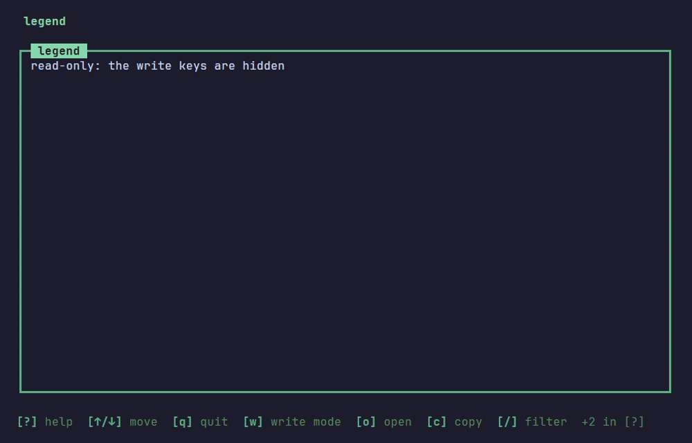

### Palette

Source: [`examples/palette/main.go`](examples/palette/main.go)

The `:` command line. A name completes with `tab`, a command takes an argument, and one that is unknown or not allowed says so on the status row.

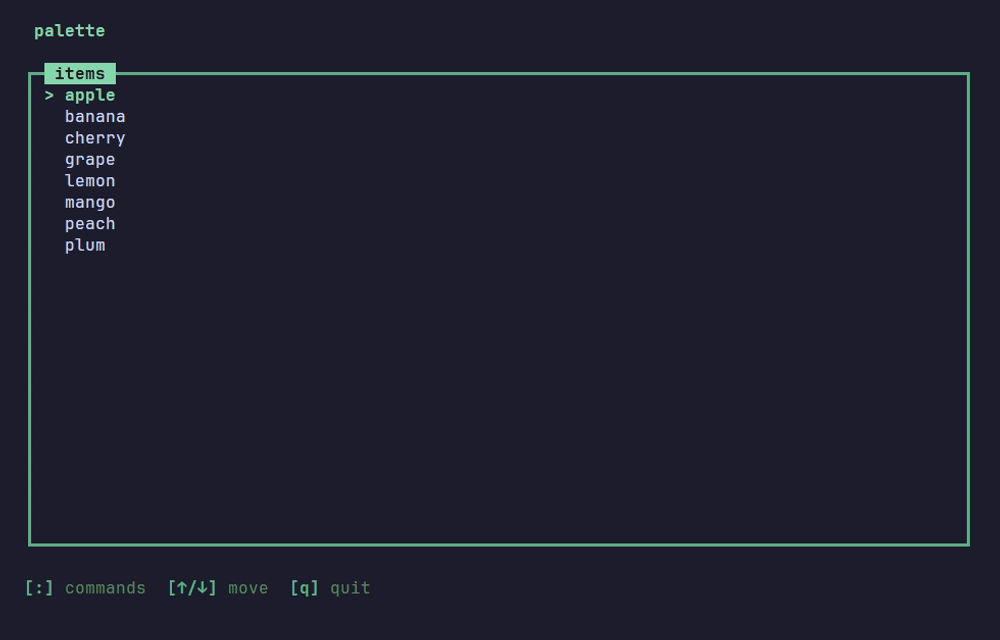

## Inside the panes

### List

Source: [`examples/list/main.go`](examples/list/main.go)

Rows under section headings the cursor skips, `enter` showing the payload a row carries, and a `/` filter that takes every key, `q` included.

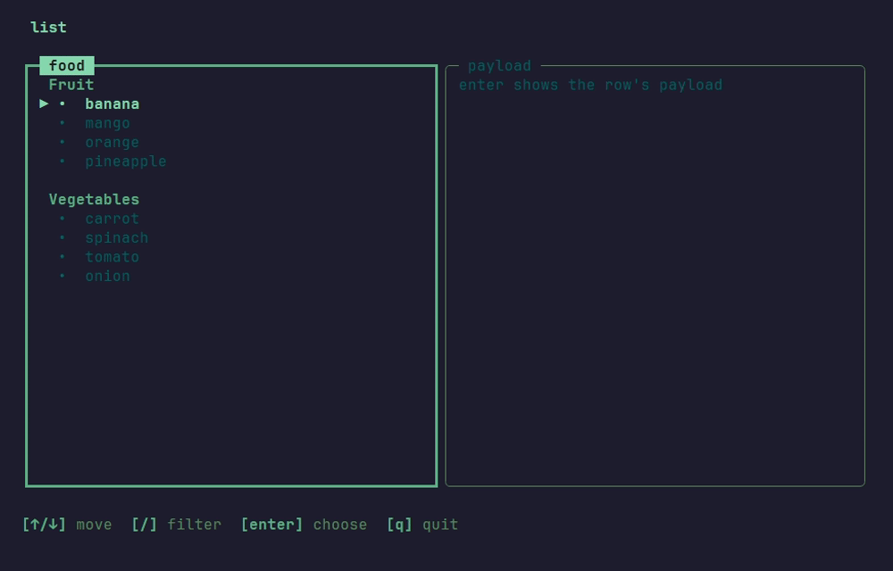

### Tree

Source: [`examples/tree/main.go`](examples/tree/main.go)

A directory tree over the app's own node type. The arrows expand and collapse; `:reveal` opens every parent on the way down to a path.

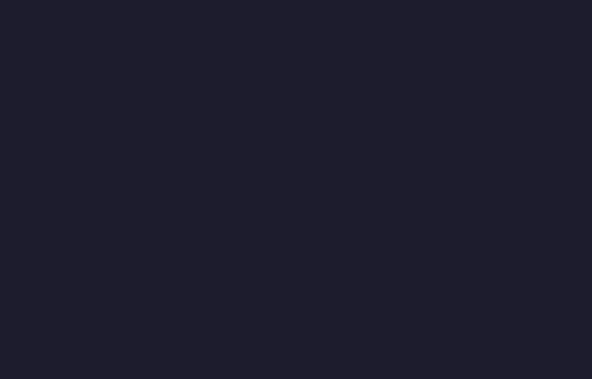

### Table

Source: [`examples/table/main.go`](examples/table/main.go)

Columns sized to their contents. `w` narrows the window: the description gives way first, and the version and licence stay whole.

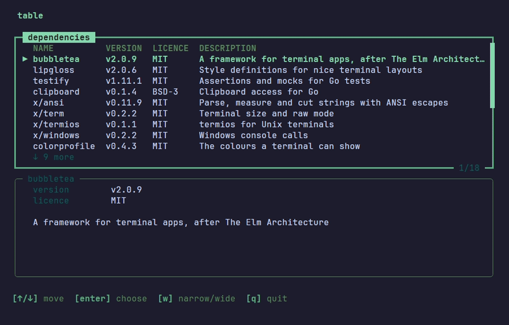

### Form

Source: [`examples/form/main.go`](examples/form/main.go)

One of each control: a name typed into an `Input`, an image picked from a `Select` that opens under it, a `Radio`, a `Toggle` and a `Checkbox`, then the `Button` that submits. `tab` and `shift+tab` move between them; Create reports the values on the status row.


### Textbox

Source: [`examples/textbox/main.go`](examples/textbox/main.go)

A multi-line value with its lines numbered. Every key is text, so the app quits on `esc`; `ctrl+s` counts the lines.

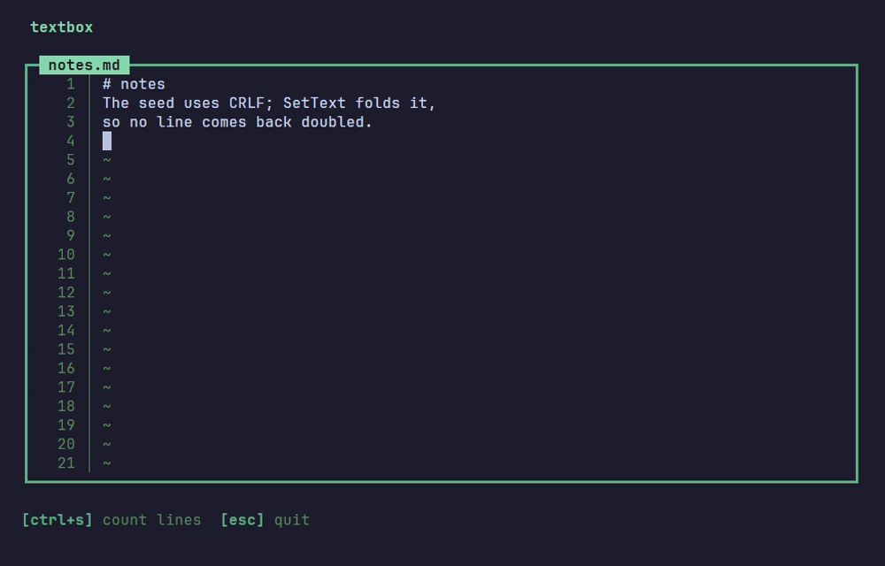

### Browser

Source: [`examples/browser/main.go`](examples/browser/main.go)

Recipe names on the left, the selected recipe on the right. `tab` moves the keys to the recipe so it scrolls, and back.


### Progress

Source: [`examples/progress/main.go`](examples/progress/main.go)

A count that fills on its own, as a `Line` and as a bare `Bar`, and a wizard's stages in a `Stepper`. `n` and `p` walk the stages; the copy drawn at 30 columns folds to "Step 2 of 4". `r` restarts the count.

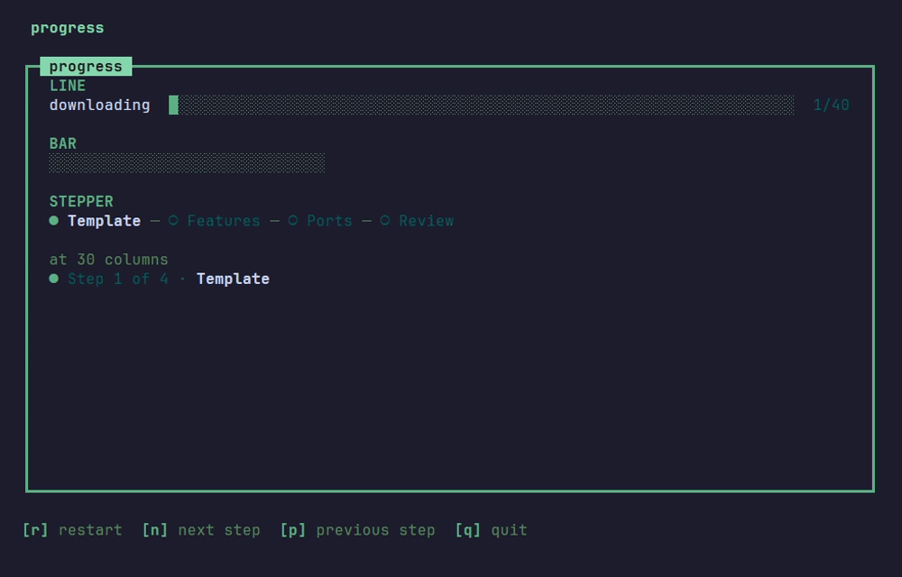

### Icon

Source: [`examples/icon/main.go`](examples/icon/main.go)

Every state mark in both sets, then a list of packages and a source chain drawn as a tree. `a` swaps them between Unicode and ASCII, the set `BEZEL_ASCII` or `TERM=dumb` picks on its own.


## Around it

### Inline

Source: [`examples/inline/main.go`](examples/inline/main.go)

A CLI that prints logs, asks one question below them, then redraws a progress bar in place. Nothing takes over the screen.

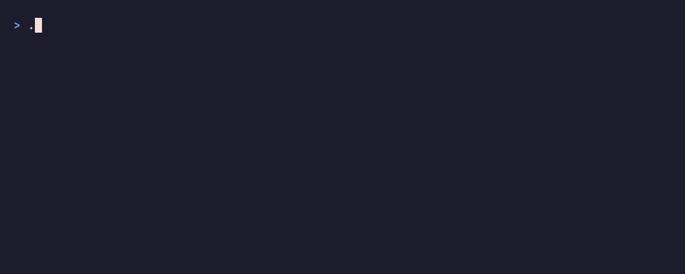

### Themebrowser

Source: [`examples/themebrowser/main.go`](examples/themebrowser/main.go)

The table a `--list-themes` flag prints: scrollable in a terminal, plain lines in a pipe.

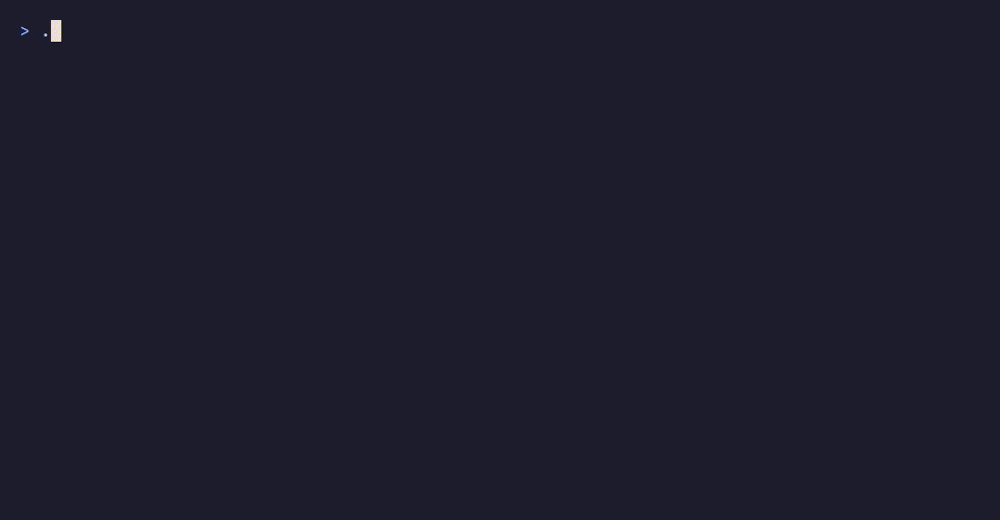

### Animation

Source: [`examples/animation/main.go`](examples/animation/main.go)

A hints pane that slides open and shut on `h`: a tween eases its height and the layout follows it frame by frame.

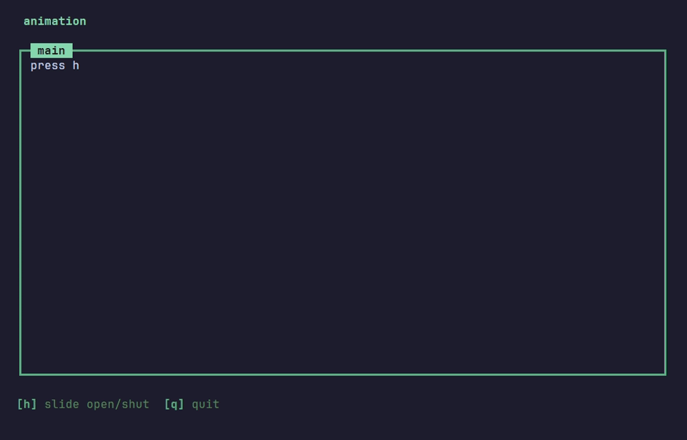

### Bezeltest

Source: [`examples/bezeltest/main_test.go`](examples/bezeltest/main_test.go)

No recording: this one is a test. A counter, and the test that drives it with the key presses a terminal would send.

## Recording

The tapes are written for Windows: each sets `Set Shell "powershell"`, builds a `.exe` off camera and deletes it when done. A full-screen example also starts and quits off camera, so its GIF opens and loops on the program; `inline` and `themebrowser` keep the command on camera, because the prompt is part of what they show. They draw 1000 px wide in JetBrainsMono Nerd Font at 16px, so GitHub shows them close to full size, and 640 px tall unless the example needs another height. With [VHS](https://github.com/charmbracelet/vhs), `ttyd` and `ffmpeg` on the `PATH` and the font installed, from the repository root:

```sh
vhs examples/list/list.tape
```

From the root, always: `Output` resolves against the working directory, not against the tape. Without the font, VHS falls back to another monospace and the recording drifts from the others.
