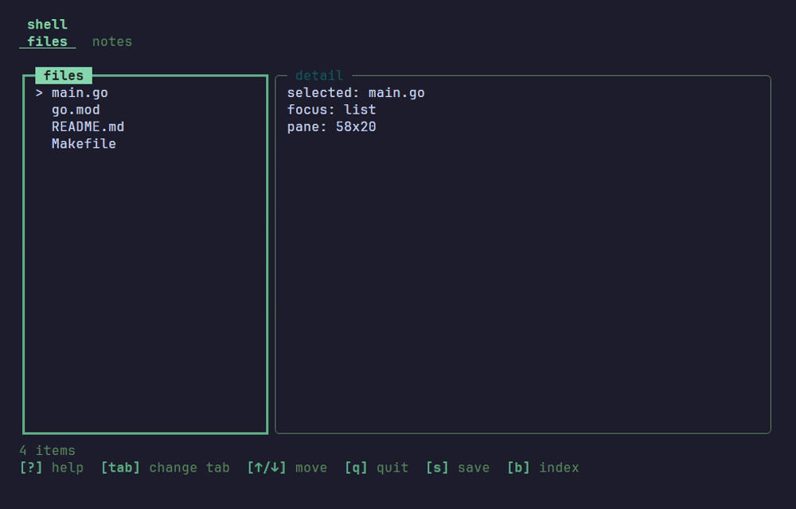
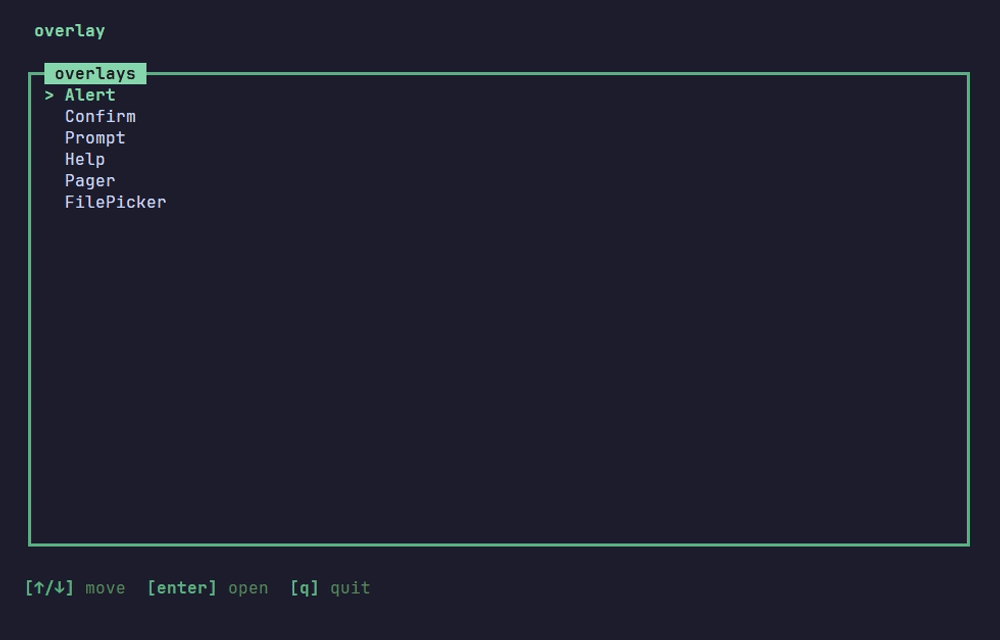

<p align="left">
  <picture>
    <source media="(prefers-color-scheme: dark)" srcset="docs/icons/bezel_horizontal_on_dark.png">
    
  </picture>
</p>

The frame around a [Bubble Tea](https://github.com/charmbracelet/bubbletea) v2. bezel owns resize, tabs, focus, overlays, the status row and the key legend; your app only draws what goes *inside* the panes.

```sh
go get github.com/lucasassuncao/bezel
```

## Shape of an app

```go
sh := shell.New(shell.Config{
    Layout: layout.Columns(
        layout.Fixed("list", layout.Ratio(1, 3), layout.Min(26), layout.Max(52)),
        layout.Fill("detail"),
    ).Collapse(72, "detail"),
    Tabs:    tabs, // each implements shell.Tab: Name(), Status(ctx) and Actions(ctx)
    Theme:   theme.Resolve(theme.Mint, true), // re-resolve on tea.BackgroundColorMsg
    Title:   "my app",
    Actions: []shell.Action{shell.Help(), shell.ChangeTab(), shell.Move(), shell.Quit()},
})

func (m model) Update(msg tea.Msg) (tea.Model, tea.Cmd) {
    var handled bool
    var cmd tea.Cmd
    if m.sh, handled, cmd = m.sh.Update(msg); handled {
        return m, cmd // resize, overlays and every action: the shell's
    }
    // the messages your actions Send, and the keys no action claims
}

func (m model) View() tea.View {
    return tea.NewView(m.sh.View(map[string]shell.Pane{
        "list":   {Title: "Items", Body: m.renderList},   // func(inner layout.Rect) string
        "detail": {Title: m.path,  Body: m.renderDetail},
    }))
}
```

A pane missing from the map gives its space back that frame.

## Examples

### Shell

Source: [`examples/shell/main.go`](examples/shell/main.go)

Two tabs and two panes. `s` sets a status that clears itself, `b` shows the busy spinner until the work is done, `tab` switches tab and `?` lists every key.



### Overlay

Source: [`examples/overlay/main.go`](examples/overlay/main.go)

The ready-made modals, one per row: an alert, a confirm that answers the app, a prompt that refuses an empty name, the help list, a pager over a command's output and a file picker. `enter` opens the one under the cursor and `esc` closes it.



### Form

Source: [`examples/form/main.go`](examples/form/main.go)

One of each control: a name typed into an `Input`, an image picked from a `Select` that opens under it, a `Radio`, a `Toggle` and a `Checkbox`, then the `Button` that submits. `tab` and `shift+tab` move between them; Create reports the values on the status row.


Every package has its own example and recording in [EXAMPLES.md](EXAMPLES.md). For all of them at once, run the demo; `DEMO_RW=1` turns on its write-gated key:

```sh
go run ./examples/demo
```

## Packages

**The frame**

- [`shell`](shell): the struct you embed. Tabs, focus, status, a busy spinner, overlays and the legend; keys are `Action`s that drive the key, the legend and the palette at once.
- [`layout`](layout): the screen as a tree of `Columns`, `Rows`, `Fixed` and `Fill`, resolved to rects. `Collapse` drops a pane below a width.
- [`theme`](theme): semantic colours, 59 presets, and the styles every package draws with.
- [`overlay`](overlay): a stack of modals: `Alert`, `Confirm`, `Prompt`, `Pick`, `Choice`, `Help`, `Pager`, `FilePicker`.
- [`draw`](draw): ANSI-safe text fitting, panels (text and a scrollbar in their edges), cards, header, tabs, dividers and buttons.
- [`legend`](legend): key hints, filtered by what the session allows and packed into a few rows.
- [`palette`](palette): the `:` command line, with completion and arguments.

**Inside the panes**

- [`list`](list): a cursor list with sections and a `/` filter.
- [`tree`](tree): an expandable tree, generic over your node type.
- [`table`](table): columns sized to their contents within a width, and a cursor over rows that scroll under a fixed header.
- [`form`](form): `Input`, `Select`, `Checkbox`, `Radio`, `Toggle` and `Button`, lined up in one column.
- [`textbox`](textbox): a multi-line text field with line numbers.
- [`browser`](browser): a list on the left, the selected item's detail on the right.
- [`progress`](progress): `Bar`, `Line`, `Smooth`, `Meter` and `Stepper`, each one row.
- [`chart`](chart): `Area` and `Spark` charts of a run of numbers, and labelled `Bars` side by side.
- [`icon`](icon): state marks (✓ ✗ ● ○) in Unicode or ASCII.

**Around it**

- [`inline`](inline): a yes/no question and a progress bar for CLIs that print logs.
- [`themebrowser`](themebrowser): the preset table behind a `--list-themes` flag.
- [`animation`](animation): an eased tween for panels that slide open.
- [`bezeltest`](bezeltest): key presses for tests that drive a model.

Every package follows the same rules for where the theme goes and how `Update` looks: see [CONVENTIONS.md](CONVENTIONS.md).
