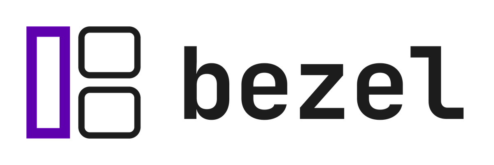
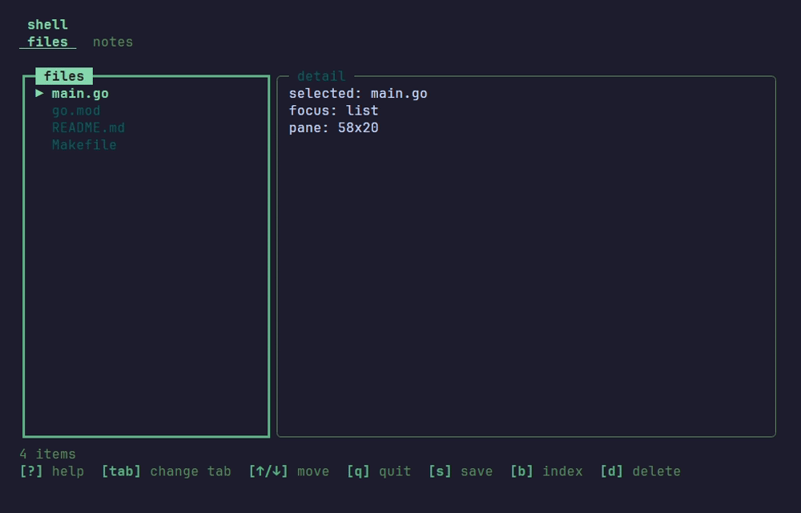
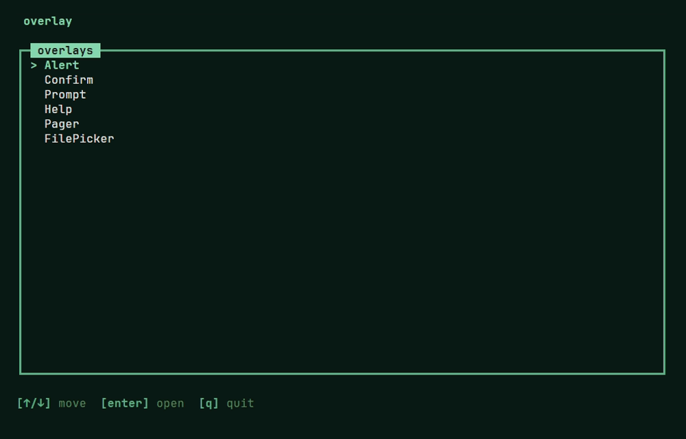
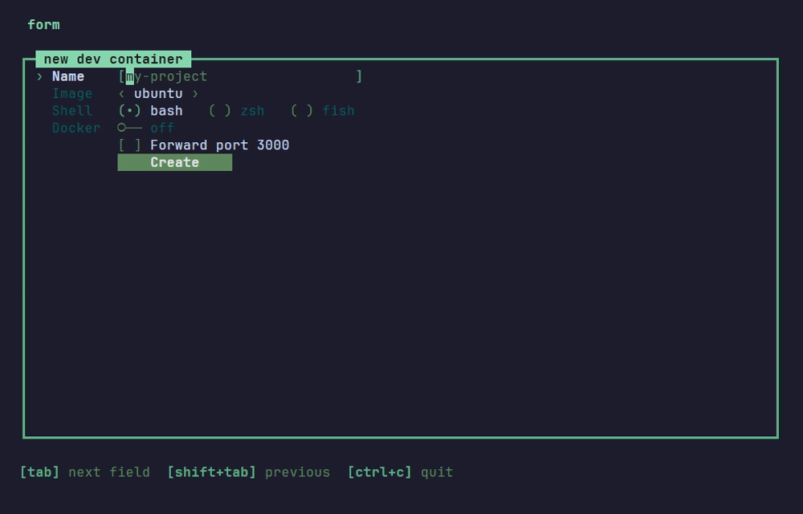
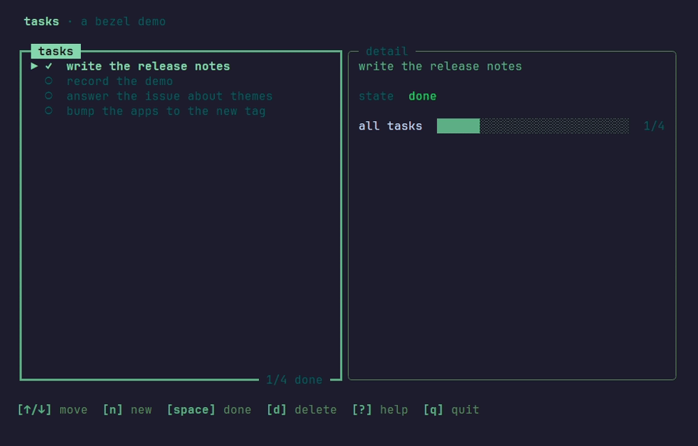

<p align="left">
  <picture>
    <source media="(prefers-color-scheme: dark)" srcset="docs/icons/bezel_horizontal_on_dark.png">
    
  </picture>
</p>

A TUI framework for [Bubble Tea](https://github.com/charmbracelet/bubbletea) v2. bezel owns the frame: resize, tabs, focus, overlays, the status row and the key legend. Your app draws what goes *inside* the panes, with components, effects and animations that share one theme.

```sh
go get github.com/lucasassuncao/bezel
```

## Shape of an app

```go
sh := shell.New(shell.Config{
    Layout: layout.Columns(
        layout.Fixed("list", layout.Ratio(1, 3), layout.Min(26), layout.Max(52)),
        layout.Fill("detail"),
    ).Collapse(72, "detail"),
    Tabs:    tabs, // each implements shell.Tab: Name(), Status(ctx) and Actions(ctx)
    Theme:   theme.Resolve(theme.Mint, true), // re-resolve on tea.BackgroundColorMsg
    Title:   "my app",
    Actions: []shell.Action{shell.Help(), shell.ChangeTab(), shell.Move(), shell.Quit()},
})

func (m model) Update(msg tea.Msg) (tea.Model, tea.Cmd) {
    var handled bool
    var cmd tea.Cmd
    if m.sh, handled, cmd = m.sh.Update(msg); handled {
        return m, cmd // resize, overlays and every action: the shell's
    }
    // the messages your actions Send, and the keys no action claims
}

func (m model) View() tea.View {
    return tea.NewView(m.sh.View(map[string]shell.Pane{
        "list":   {Title: "Items", Body: m.renderList},   // func(inner layout.Rect) string
        "detail": {Title: m.path,  Body: m.renderDetail},
    }))
}
```

A pane missing from the map gives its space back that frame.

## Documentation

| Guide | What it covers |
|---|---|
| [A first app](docs/EXAMPLE.md) | a small task list built step by step, from the model to its tests |
| [The frame](docs/FRAME.md) | the shell, layout, tabs, actions, focus, status row, dialogs and palette |
| [Theme](docs/THEME.md) | the presets, a theme of your own, light and dark, recolouring one component |
| [Components](docs/COMPONENTS.md) | every package's example and recording |
| [Effects](docs/EFFECTS.md) | effects, lights and transitions over a drawn block |
| [Animations](docs/ANIMATIONS.md) | tweens, springs, physics, text and scenes, and the clock that drives them |
| [Architecture](docs/ARCHITECTURE.md) | what each folder holds, and what may import what |
| [Conventions](docs/CONVENTIONS.md) | the rules every package follows: where the theme goes, the shapes of `Update` |

Each package also has its own `README.md`, generated from its doc comments.

## Examples

### Shell

Source: [`examples/frame/shell/main.go`](examples/frame/shell/main.go)

Two tabs and two panes. `s` sets a status that clears itself, `b` shows the busy spinner until the work is done, `tab` switches tab and `?` lists every key.



### Overlay

Source: [`examples/frame/overlay/main.go`](examples/frame/overlay/main.go)

The ready-made modals, one per row: an alert, a confirm that answers the app, a prompt that refuses an empty name, the help list, a pager over a command's output and a file picker. `enter` opens the one under the cursor and `esc` closes it.



### Form

Source: [`examples/component/form/main.go`](examples/component/form/main.go)

One of each control: a name typed into an `Input`, an image picked from a `Select` that opens under it, a `Radio`, a `Toggle` and a `Checkbox`, then the `Button` that submits. `tab` and `shift+tab` move between them; Create reports the values on the status row.



Every package has its own example and recording in [COMPONENTS.md](docs/COMPONENTS.md); the effects have [EFFECTS.md](docs/EFFECTS.md) and the animations [ANIMATIONS.md](docs/ANIMATIONS.md).

### A first app

Source: [`examples/app/main.go`](examples/app/main.go)

A task list built from a few of them: a list, a progress line, a prompt to add a task and a confirm to delete one. [EXAMPLE.md](docs/EXAMPLE.md) walks through the code step by step; `--read-only` hides the keys that change the list.



```sh
go run ./examples/app
```

## Packages

**The frame**, at the root: what every screen is built in.

- [`shell`](shell): the struct you embed. Tabs, focus, status, a busy spinner, overlays and the legend; keys are `Action`s that drive the key, the legend and the palette at once.
- [`layout`](layout): the screen as a tree of `Columns`, `Rows`, `Fixed` and `Fill`, resolved to rects. `Collapse` drops a pane below a width.
- [`theme`](theme): semantic colours, 59 presets, and the styles every package draws with.
- [`overlay`](overlay): a stack of modals: `Alert`, `Confirm`, `Prompt`, `Pick`, `Choice`, `Help`, `Pager`, `FilePicker`.
- [`draw`](draw): ANSI-safe text fitting, panels (text and a scrollbar in their edges), cards, header, tabs, dividers and buttons.
- [`legend`](legend): key hints, filtered by what the session allows and packed into a few rows.
- [`key`](key): key bindings, with the help the legend prints; a `Binding` is a value, switched off by its `Disabled` field.
- [`palette`](palette): the `:` command line, with completion and arguments.
- [`bezeltest`](bezeltest): key presses for tests that drive a model.

**Components**, in [`component`](component): what goes inside the panes.

- [`list`](component/list): a cursor list with sections and a `/` filter.
- [`paginator`](component/paginator): pages as dots or "2/5", and the slice of items each page shows.
- [`tree`](component/tree): an expandable tree, generic over your node type.
- [`table`](component/table): columns sized to their contents within a width, and a cursor over rows that scroll under a fixed header.
- [`form`](component/form): `Input`, `Select`, `Checkbox`, `Radio`, `Toggle` and `Button`, lined up in one column.
- [`input`](component/input): a one-line text field with readline keys, a placeholder and a mask for secrets.
- [`textbox`](component/textbox): a multi-line text field with line numbers.
- [`viewport`](component/viewport): scrollable text, wrapped or panned, with line numbers and search highlights.
- [`cursor`](component/cursor): a caret that blinks, stays or hides, for fields of your own.
- [`browser`](component/browser): a list on the left, the selected item's detail on the right.
- [`accordion`](component/accordion): sections that open and close onto their text, sliding.
- [`progress`](component/progress): `Bar`, `Line`, `Smooth`, `Meter` and `Stepper`, each one row.
- [`spinner`](component/spinner): twelve spinners and your own frames, each ticking on its own.
- [`timer`](component/timer): a countdown that says when time is up.
- [`stopwatch`](component/stopwatch): time counted up, paused and reset.
- [`chart`](component/chart): `Area` and `Spark` charts of a run of numbers, and labelled `Bars` side by side.
- [`icon`](component/icon): state marks (✓ ✗ ● ○) in Unicode or ASCII.
- [`toast`](component/toast): notices that slide into a corner, stack and leave on their own.
- [`inline`](component/inline): a yes/no question and a progress bar for CLIs that print logs.
- [`themebrowser`](component/themebrowser): the preset table behind a `--list-themes` flag.

**Effects**

- [`effect`](effect): effects and lights over any drawn block (fades, dissolves, slides, a melt, a tint, a spotlight, a hover), kept to rows or a part of it, transitions from one block to the next, and intent presets.

**Animation**

- [`animation`](animation): tweens on a dozen easing curves that delay, repeat and yoyo, springs, points, physics (a drop, a pendulum, an orbit, a flock, a rubber band) and animated chart values, with one clock to drive them; `BEZEL_NO_MOTION` turns motion off and `BEZEL_MOTION` sets its speed.
- [`animation/text`](animation/text): text that types, scrolls, shimmers, scrambles, rolls, waves, decrypts, blinks and rises.
- [`animation/scene`](animation/scene): rain, snow, confetti, fireworks, stars, static and plasma, alone or behind a block.
