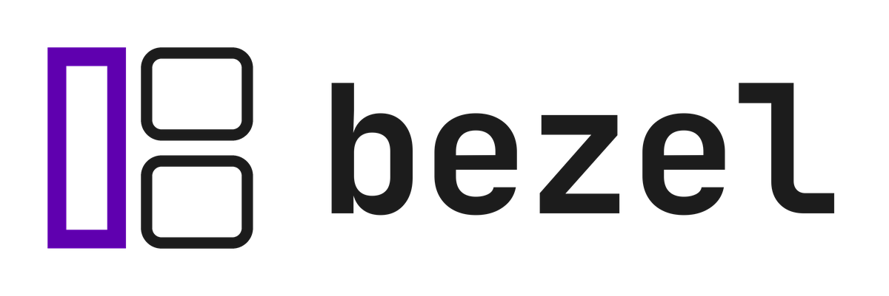
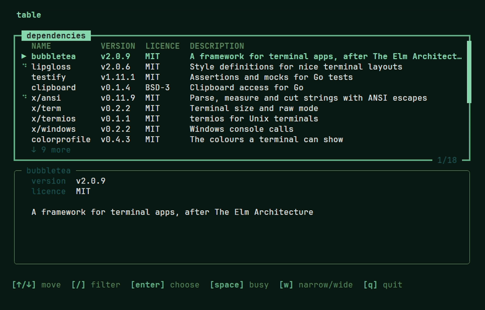
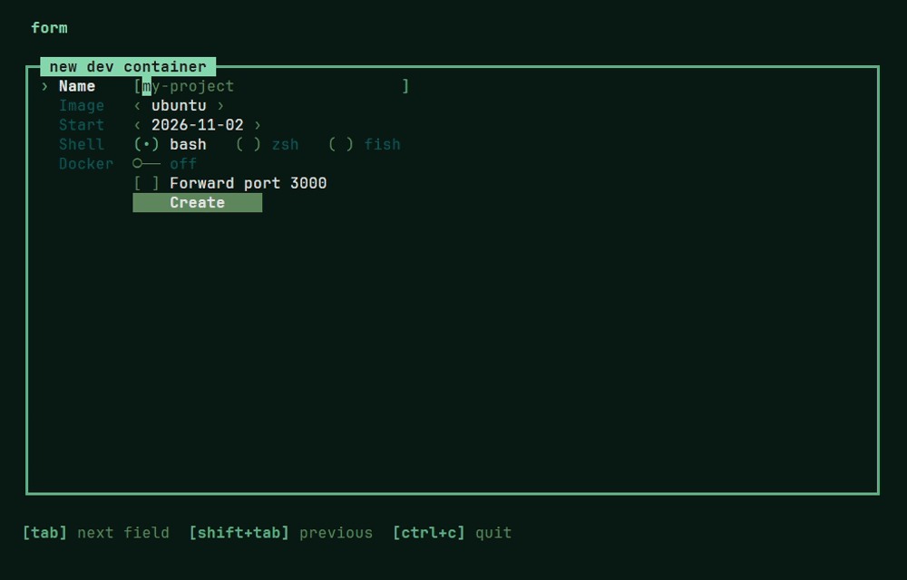
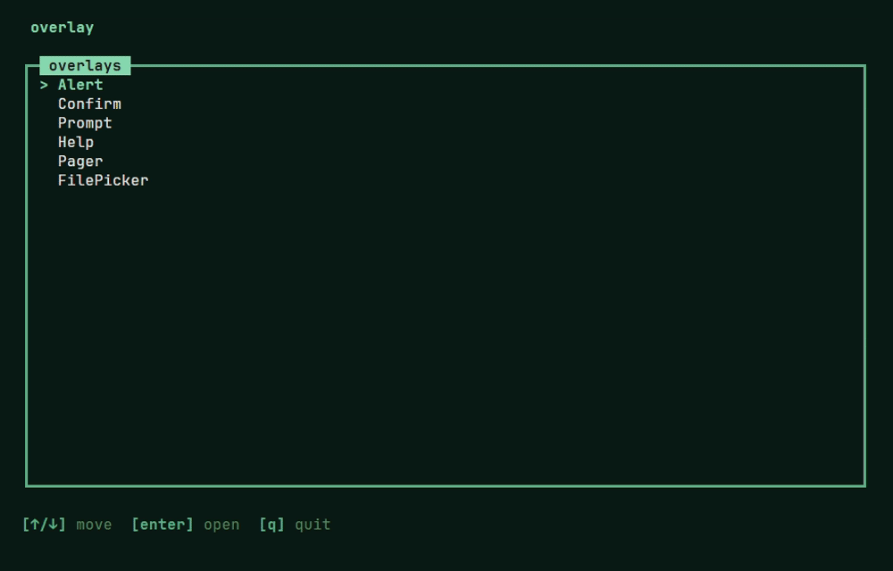
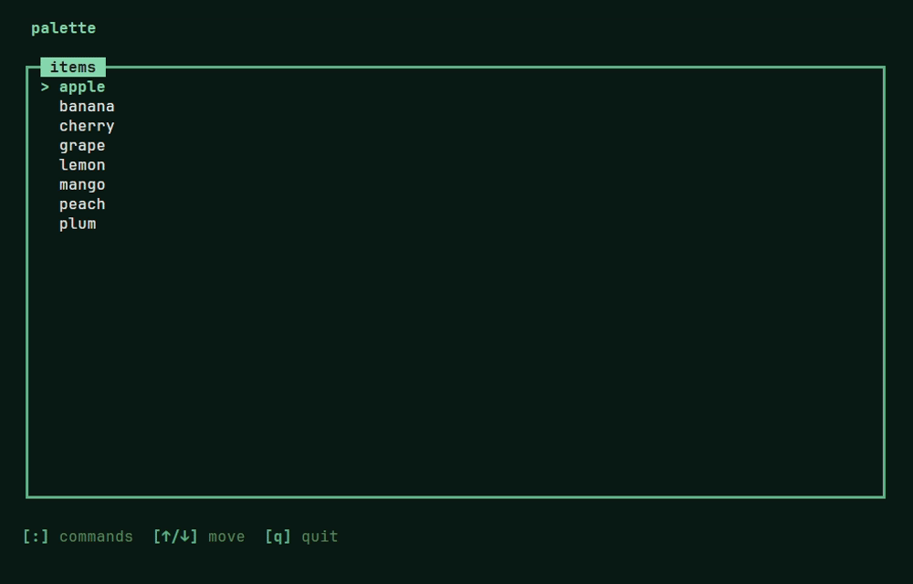
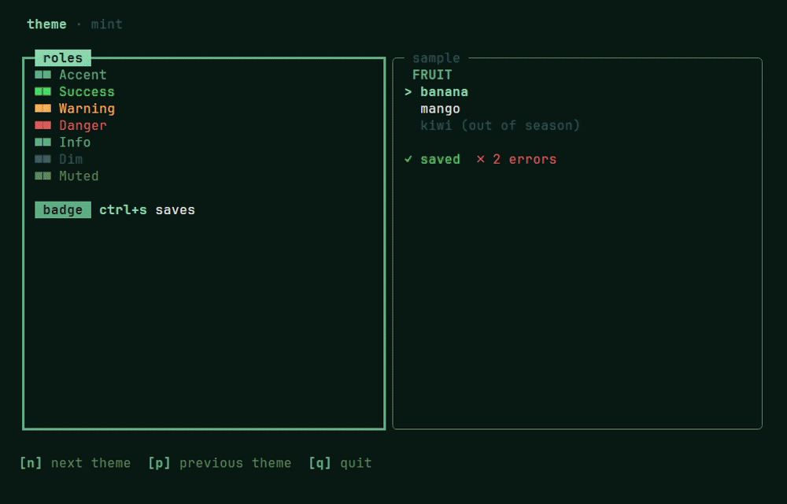
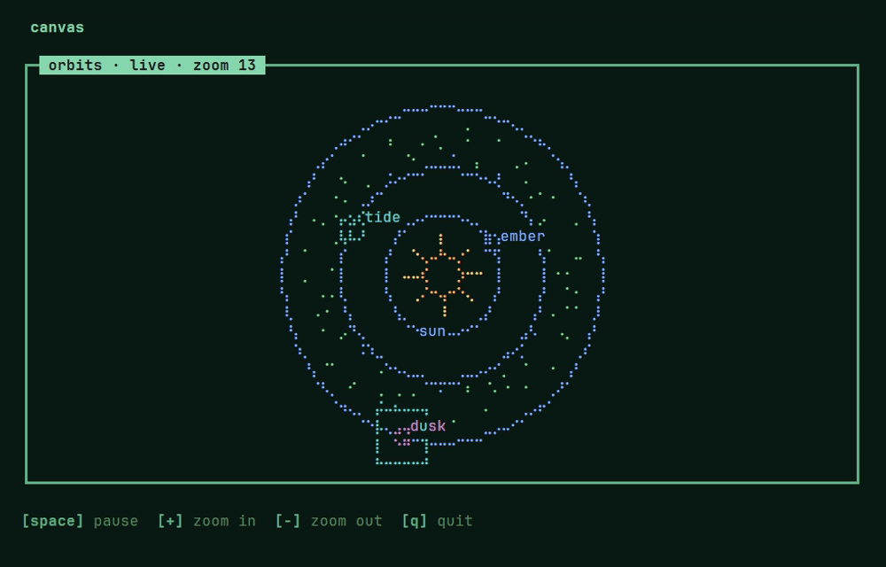
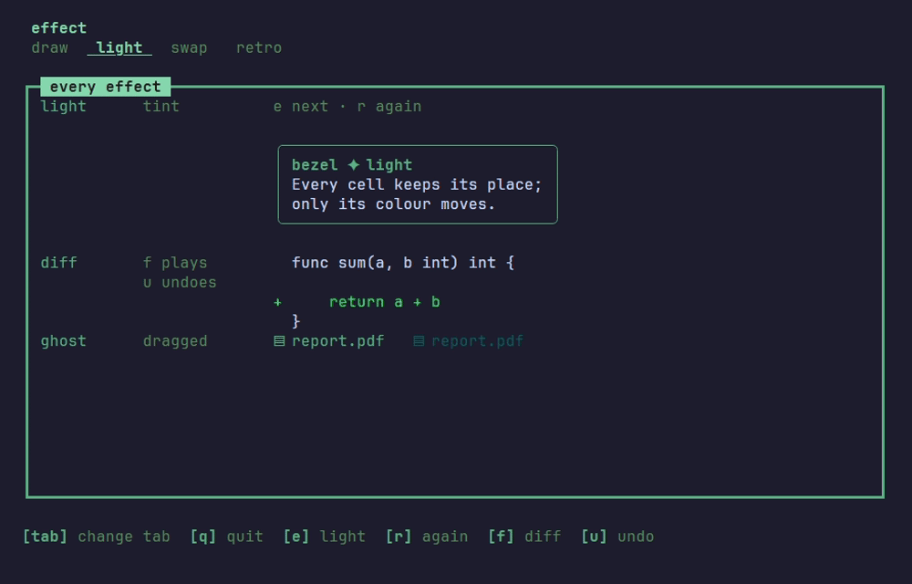
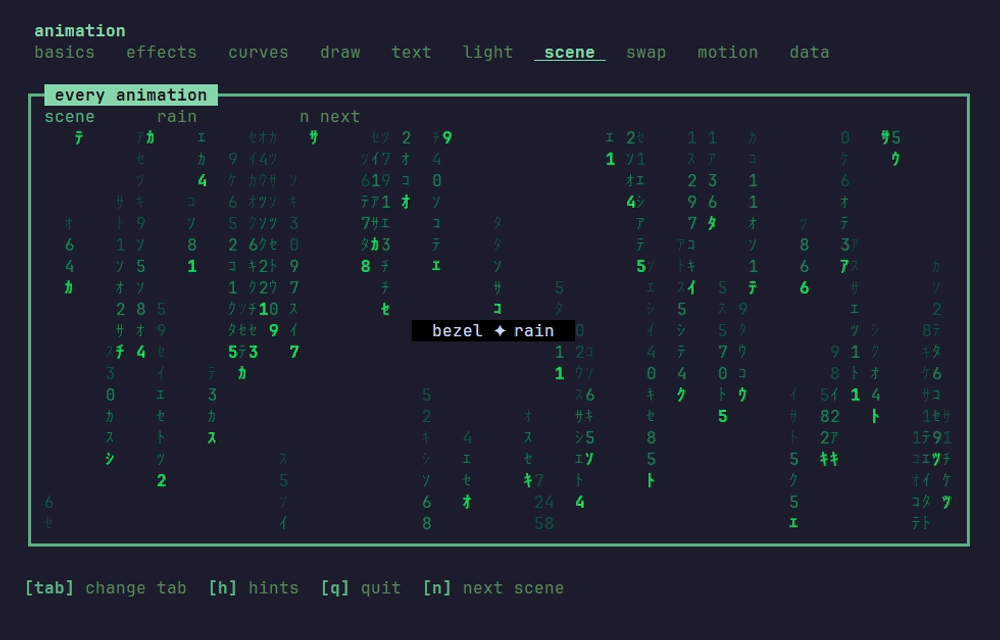

<p align="left">
  <picture>
    <source media="(prefers-color-scheme: dark)" srcset="docs/icons/bezel_horizontal_on_dark.png">
    
  </picture>
</p>

[](https://pkg.go.dev/github.com/lucasassuncao/bezel)
[](https://github.com/lucasassuncao/bezel/actions/workflows/ci.yml)
[](https://github.com/lucasassuncao/bezel/releases)
[](LICENSE)

**bezel is a framework for building terminal user interfaces (TUIs) in Go.**

Layout, widgets, themes, dialogs, key bindings and animation in one library, so you write your app and not the plumbing around it. Built on [Bubble Tea](https://github.com/charmbracelet/bubbletea) v2.


Try it without cloning anything:

```sh
go run github.com/lucasassuncao/bezel/examples/app@latest
```

## Why bezel

- **The whole screen is handled.** Resize, panes, tabs, focus, a status row, a busy spinner and a key legend come with the frame. You only draw what goes inside each pane.
- **Layout as a tree.** Columns and rows of fixed, ratio and fill panes, with min/max sizes and panes that collapse on narrow terminals.
- **Over 25 widgets.** Lists, tables, trees, forms, a text editor, charts, a braille canvas, calendars, progress bars, toasts and more.
- **Dialogs ready to use.** Alert, confirm, prompt, pickers, a pager, a file picker, a help screen and a `:` command palette.
- **One theme for everything.** Sixteen presets, light and dark, and every widget recolours with them.
- **Keys you declare once.** An action's key, its legend entry and its palette command come from the same place.
- **Motion when you want it.** Tweens, springs, physics, text effects, transitions and scenes, all driven by messages, so they are testable and can be switched off.
- **Easy to test.** Press keys in a test, check the rendered screen, and compare it with a golden file.
- **Works outside full-screen apps too.** Ask questions, show progress bars and print logs in a plain CLI.

## Gallery

<table>
  <tr>
    <td><a href="docs/COMPONENTS.md"></a></td>
    <td><a href="docs/COMPONENTS.md"></a></td>
    <td><a href="docs/COMPONENTS.md"></a></td>
  </tr>
  <tr>
    <td><a href="docs/FRAME.md"></a></td>
    <td><a href="docs/FRAME.md"></a></td>
    <td><a href="docs/THEME.md"></a></td>
  </tr>
  <tr>
    <td><a href="docs/COMPONENTS.md"></a></td>
    <td><a href="docs/EFFECTS.md"></a></td>
    <td><a href="docs/ANIMATIONS.md"></a></td>
  </tr>
</table>

Every package has its own example and recording in [COMPONENTS.md](docs/COMPONENTS.md), [EFFECTS.md](docs/EFFECTS.md) and [ANIMATIONS.md](docs/ANIMATIONS.md).

## Quickstart

```sh
go get github.com/lucasassuncao/bezel
```

A whole program: a list on the left, the selected item on the right, and the keys at the bottom. It is also [`examples/quickstart`](examples/quickstart/main.go), so `go run ./examples/quickstart` runs it, and its test keeps this copy compiling.

```go
package main

import (
	"fmt"
	"os"

	tea "charm.land/bubbletea/v2"

	"github.com/lucasassuncao/bezel"
	"github.com/lucasassuncao/bezel/component/list"
	"github.com/lucasassuncao/bezel/draw"
	"github.com/lucasassuncao/bezel/layout"
	"github.com/lucasassuncao/bezel/shell"
	"github.com/lucasassuncao/bezel/theme"
)

type model struct {
	sh   shell.Shell
	th   theme.Resolved
	list list.Model[string]
}

func newModel() model {
	th := theme.Resolve(theme.Mint(), true)
	return model{
		th: th,
		sh: shell.New(shell.Config{
			Title: "fruit",
			Theme: th,
			Layout: layout.Columns(
				layout.Fixed("list", layout.Ratio(1, 3), layout.Min(20)),
				layout.Fill("detail"),
			),
			Actions: []shell.Action{shell.Move(), shell.Help(), shell.Quit()},
		}),
		list: list.New([]list.Row[string]{
			{Label: "apple", Value: "red and crisp"},
			{Label: "banana", Value: "yellow and soft"},
			{Label: "cherry", Value: "small and sweet"},
		}),
	}
}

func (m model) Init() tea.Cmd { return nil }

func (m model) Update(msg tea.Msg) (tea.Model, tea.Cmd) {
	// The shell goes first: resize, dialogs and the keys of its actions.
	var r bezel.Result
	if m.sh, r = m.sh.Update(msg); r.Handled {
		return m, r.Cmd
	}
	// Whatever is left is yours: here, the arrows move the list.
	m.list = m.list.SetHeight(draw.InnerRect(m.sh.Rect("list")).H)
	m.list, r = m.list.Update(msg)
	return m, r.Cmd
}

func (m model) View() tea.View {
	return m.sh.View(map[string]shell.Pane{
		"list": {Title: "Fruit", Body: func(layout.Rect) string {
			return m.list.View(m.th)
		}},
		"detail": {Title: "Detail", Body: func(layout.Rect) string {
			row, _ := m.list.Selected()
			return row.Value
		}},
	})
}

func main() {
	if _, err := tea.NewProgram(newModel()).Run(); err != nil {
		fmt.Fprintln(os.Stderr, err)
		os.Exit(1)
	}
}
```

What it draws, after one press of `↓`:

```text
 fruit

┏━ Fruit ━━━━━━━━━━━━━┓╭─ Detail ────────────────────────────────────╮
┃   apple             ┃│ yellow and soft                             │
┃ ▶ banana            ┃│                                             │
┃   cherry            ┃│                                             │
┃                     ┃│                                             │
┗━━━━━━━━━━━━━━━━━━━━━┛╰─────────────────────────────────────────────╯

[↑/↓] move  [?] help  [q] quit
```

Resizing the terminal, the borders, the focused pane, the help screen on `?` and quitting on `q` all came from the shell. The program only said what the panes are and what goes in them. [A first app](docs/EXAMPLE.md) takes it further: adding and deleting items, a confirm dialog, a status message and tests.

## How it fits with Bubble Tea

bezel doesn't replace [Bubble Tea](https://github.com/charmbracelet/bubbletea); it sits inside it. You still write a `tea.Model` and run it with `tea.NewProgram`, and every Bubble Tea message reaches you as usual. bezel gives that model the pieces a real app needs:

- `shell.Shell` is the screen around your content. Put it in your model and pass it each message first; it tells you if it used the message.
- The components (`list`, `table`, `form`, ...) are values with the same `Update` and `View` shape, so they slot into your model the same way.
- Nothing is global and nothing reads the clock, so a test can drive the whole app with key presses and check what it draws.

## Requirements

- Go 1.26 or newer.
- Any modern terminal. Colours are brought down to what the terminal can show, and `BEZEL_ASCII=1` draws the state marks (✓ ✗ ●) in ASCII.
- Tested on Linux, macOS and Windows in CI.

The API may still change before v1; [STABILITY.md](docs/STABILITY.md) says which packages are stable and what a minor release may change.

## What's inside

- **The frame:** `shell`, `layout`, `theme`, `overlay` (dialogs), `draw`, `legend`, `key`, and `bezeltest` for tests.
- **Components:** list, table, tree, form, wizard, input, textbox, viewport, file picker, calendar, chart, canvas, progress, spinner, timer, stopwatch, toast, logger, and more.
- **Effects:** fades, dissolves, slides, lights and transitions over anything already drawn.
- **Animation:** tweens, springs, physics, text effects and full-screen scenes.

The full list, with a line on each package, is in [PACKAGES.md](docs/PACKAGES.md).

## Documentation

| Guide | What it covers |
| --- | --- |
| [A first app](docs/EXAMPLE.md) | a small task list built step by step, from the model to its tests |
| [The frame](docs/FRAME.md) | the shell, layout, tabs, actions, focus, status row, dialogs and palette |
| [Theme](docs/THEME.md) | the presets, a theme of your own, light and dark, recolouring one component |
| [A CLI without the frame](docs/CLI.md) | questions, bars and logs printed below a command's output: every form field asked on its own, with a recording each |
| [Recipes](docs/RECIPES.md) | how to test an app, write a dialog, build a CLI, add a read-only mode, take --theme, animate your own drawing |
| [Components](docs/COMPONENTS.md) | every package's example and recording |
| [Packages](docs/PACKAGES.md) | every package, grouped by what it is for |
| [Effects](docs/EFFECTS.md) | effects, lights and transitions over a drawn block |
| [Animations](docs/ANIMATIONS.md) | tweens, springs, physics, text and scenes, and the clock that drives them |
| [Architecture](docs/ARCHITECTURE.md) | what each folder holds, and what may import what |
| [Conventions](docs/CONVENTIONS.md) | the rules every package follows: where the theme goes, the one `Update` |
| [Stability](docs/STABILITY.md) | what v1 promises: the stable and the experimental packages, and what a minor release may change |

Each package also has its own `README.md`, generated from its doc comments, and its API is on [pkg.go.dev](https://pkg.go.dev/github.com/lucasassuncao/bezel).
