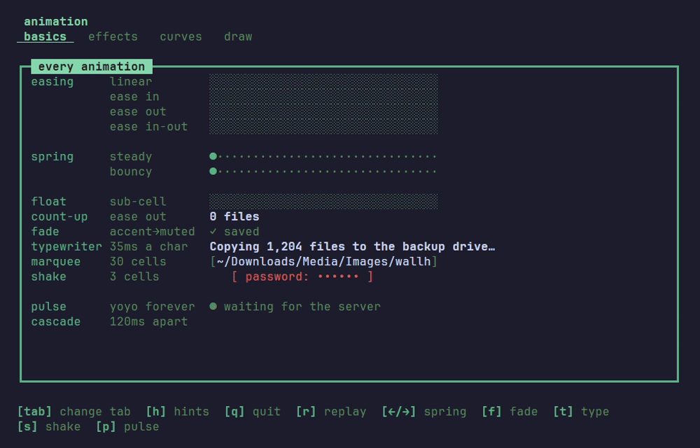
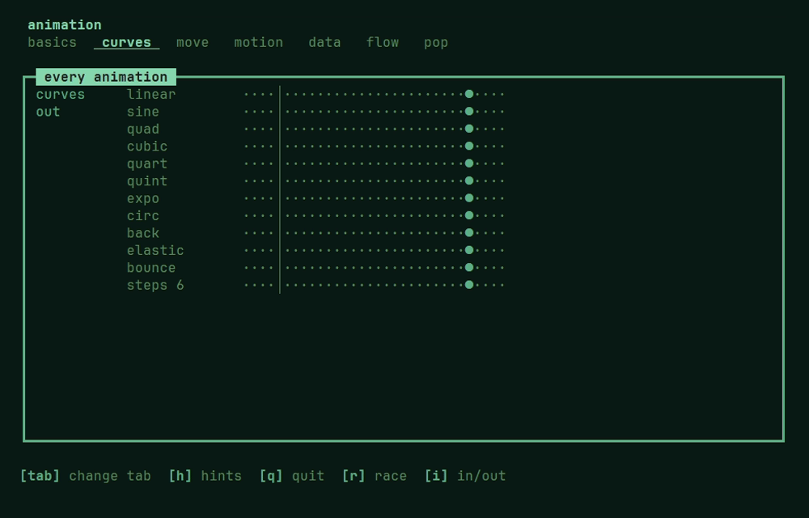
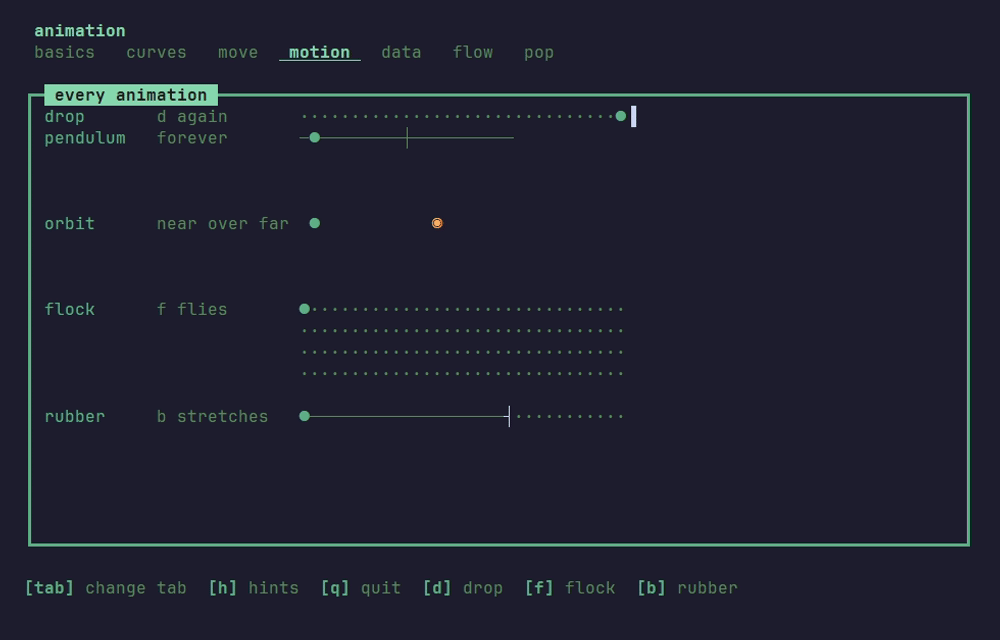
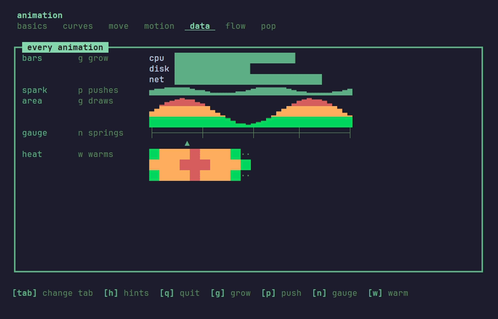
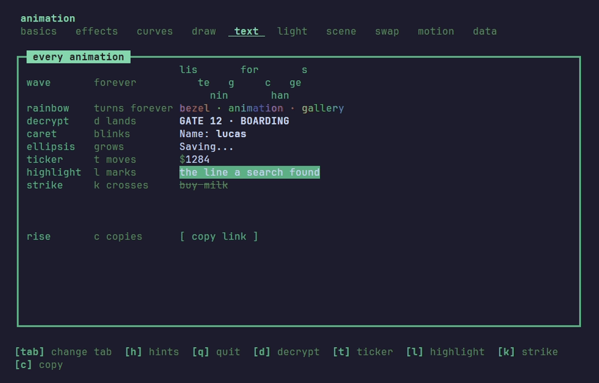
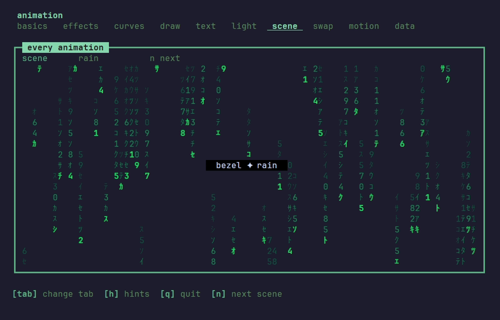

# Animations

Every animation is a value, like the rest of bezel: it reads no clock, starts on the first frame its `Tick` delivers, takes only its own frames, and hands back a changed copy. The effects that play over a drawn block live in their own package, [`effect`](../effect), and run the same way:

| Package | What it moves | Page |
|---|---|---|
| [`animation`](../animation) | values: tweens, springs, fades, points, physics and chart data, on the easing curves, and the `Clock` that drives several at once | [Motion](#motion) |
| [`animation/text`](../animation/text) | a line of text: typed, scrolled, shimmered, scrambled, rolled, waved, struck | [Text](#text) |
| [`effect`](../effect) | a block that is already drawn: fades, dissolves, slides, lights, and transitions from one block to the next | [EFFECTS.md](EFFECTS.md) |
| [`animation/scene`](../animation/scene) | whole scenes drawn from the time alone: rain, snow, stars, fireworks | [Scenes](#scenes) |

Every one of them takes the same `animation.FrameMsg`, so one screen can mix them freely. The gallery shows every kind, a tab each:

```sh
go run ./examples/animation
```

`tab` turns the page; each tab keeps its own keys, listed at the foot of the screen.

## Two ways to drive one

**On its own frames.** Start it, hand it every `animation.FrameMsg`, and draw what it holds. It asks for its next frame until it lands, and ignores the frames of every other animation.

```go
case toggleMsg:
	m.slide = animation.New(m.height, 8, 300*time.Millisecond)
	return m, m.slide.Tick()
case animation.FrameMsg:
	var cmd tea.Cmd
	m.slide, cmd = m.slide.Update(msg)
	m.height = m.slide.Cur
	return m, cmd
```

**On one `Clock`.** A screen running several at once gives them a single chain of frames: each frame, it advances every animation to the frame's time and keeps the clock going while any of them still moves.

```go
case animation.FrameMsg:
	at, ok := m.clock.Frame(msg)
	if !ok {
		return m, nil
	}
	m.bar, _ = m.bar.Advance(at)
	m.count, _ = m.count.Advance(at)
	if m.bar.Active() || m.count.Active() {
		var cmd tea.Cmd
		m.clock, cmd = m.clock.Next()
		return m, cmd
	}
	m.clock = m.clock.Stop()
```

Start the clock, `m.clock, cmd = m.clock.Start()`, whenever one of them is set off. The gallery runs its timed rows on one clock, and the marquee, the shimmer, the gradient and the hints pane on their own frames.

`Take` is `Frame` for a clock that paces itself: `m.clock, at, ok = m.clock.Take(msg)`. When frames arrive twice as far apart as it asked, the screen cannot keep up, so it asks half as often, down to a quarter of the usual rate, and speeds up again once they keep up. It reads only the times its own frames carry.

`animation.Record(a, view, limit)` plays an animation from its first frame to its end, a frame every `Frame`, and keeps what `view` draws of each: an animation as text, for a test that checks it frame by frame.

## Motion off

With `BEZEL_NO_MOTION` set to anything, or `TERM=dumb`, every animation is born where it would have ended and asks for no frame: tweens at their target, typed text whole, an effect that brings a block in showing it, one that takes it away leaving it gone. It is for a user who finds motion hard to follow, a slow link, or a CI log. `animation.Still()` reports it, for an app that times something of its own. A scene holds its first frame.

`BEZEL_MOTION` sets the speed of the rest: `2` plays everything twice as fast, `0.5` at half speed, `0` turns motion off as `BEZEL_NO_MOTION` does. Durations, delays, springs and physics all follow it; `animation.Speed()` reports it.

## Motion

The [`animation`](../animation) package moves values: a number, a colour, a point. What draws them is the app's.

### Values



| Kind | What it moves |
|---|---|
| `Tween`, `Float` | a whole number or a fraction from one value to another: a panel's height, a bar drawn in eighths |
| `Spring` | a value after a target, with speed and inertia; a new target bends the motion instead of starting it over |
| `Fade` | a colour from one to another; `Blend` mixes two at any point |
| `Move`, `Follow` | ease or spring a `Point` on both axes |

Every timed one takes `WithDelay` and `WithRepeat`, `animation.Forever` for no end, and `WithYoyo`, which runs every other pass back. Delays chain one animation after another: the gallery's cascade is six tweens, each delayed a little more than the one before. A pulse is a `Fade` with `WithYoyo().WithRepeat(animation.Forever)`.

### Curves



`Linear`, `EaseIn`, `EaseOut` and `EaseInOut`, the default, and nine more, each easing in: `Sine`, `Cubic`, `Quart`, `Quint`, `Expo`, `Circ`, `Back`, `Elastic` and `Bounce`. `Out` and `InOut` turn any of them round, and `Steps(n)` moves in whole jumps:

```go
animation.New(0, 40, time.Second).WithEase(animation.Out(animation.Back))
```

Every curve starts at exactly 0 and ends at exactly 1. `Back` and `Elastic` leave that range on the way, so what they move overshoots and settles. The text and effect kinds take the same curves.

### Physics



| Kind | What it does |
|---|---|
| `Drop` | falls under gravity and bounces, each hop lower and quicker, until it settles |
| `Pendulum` | swings either side of the middle, for ever or dying out `WithDecay` |
| `Orbit` | carries a point round an ellipse; `Near` says which half it is on, to draw it in front or behind |
| `Flock` | a line of points, each springing after the one ahead, trailing like a tail |
| `Rubber` | a value that gives past its limits, harder the farther it is pulled, and springs back when let go |

### Charts that move



A `Series` animates the values a chart draws: `NewGrow` raises them all from zero, `NewDraw` reveals them from the left, and `Push` adds one at the right that rises while the oldest drops off. `Heat` moves a grid of values cell by cell for `chart.Heat`, and a `Spring` carries the needle of `progress.Gauge`.

## Text

The [`animation/text`](../animation/text) package animates a line of text and draws it with `View`, its width kept wherever the text would jump.

### Typed and scrolled


| Kind | What it does |
|---|---|
| `Typewriter` | reveals text a grapheme at a time |
| `Marquee` | scrolls text wider than its room round and round |
| `Shake` | sways a block side to side, its width kept: a refusal without words |

### Lit and rolled


| Kind | What it does |
|---|---|
| `Shimmer` | sweeps a glow across text, over and over: a placeholder while something loads |
| `Scramble` | shows text as noise that settles from the left; the noise depends only on the frame's time |
| `Odometer` | rolls a number digit by digit, the right-hand digits spinning most; `To` rolls on to the next value |
| `Gradient` | spreads colours round a text and lets them flow along it |

### Marked and moved



| Kind | What it does |
|---|---|
| `Wave` | bobs a line letter by letter, a wave passing along it, on 2·amp+1 rows |
| `Rainbow` | spreads the colour wheel along text and turns it; `WithTone` matches a theme's accent |
| `Decrypt` | turns each letter through the flaps of a departures board until it lands, the leftmost first |
| `Caret`, `Ellipsis` | a blinking cursor, and dots that grow and start over; both keep their width |
| `Ticker` | a number that rolls to each new value in the colour of its direction, then settles |
| `Highlight`, `Strike` | a marker run under text, a line drawn through it; both stay |
| `Rise` | a word that floats up off its place and fades: "copied!", "+1" |

The timed ones take `WithEase`, `WithDelay`, `WithRepeat` and, all but `Shake`, `WithYoyo`, as the [motion](#motion) kinds do:

```go
text.NewTypewriter("Saved.", 400*time.Millisecond).WithYoyo().WithRepeat(1)
```

## Scenes



The [`animation/scene`](../animation/scene) package draws a `Scene` from the time alone, at any size, for as long as it lives: `NewRain`, `NewSnow`, `NewConfetti`, `NewFireworks`, `NewStarfield`, `NewStatic` and `NewPlasma`, each in the colours it is given.

`View(w, h)` draws it on its own; `Under(block)` draws it behind a block, which hides it wherever the block draws something:

```go
m.snow = scene.NewSnow(lipgloss.Color("#e0e8ff"))
return m, m.snow.Tick()

// on every animation.FrameMsg
m.snow, cmd = m.snow.Update(msg)

// in View
body := m.snow.Under(m.card.View())
```

A scene never ends on its own: it plays until it is replaced. With motion off it holds its first frame.
