# A CLI without the frame

Not every program wants the whole screen. A command that runs, asks a thing or two and ends can use bezel's questions, bars and logs on their own: each prints below the last line, and the terminal scrolls on as it always does. None of them needs the shell.

| Package | What it prints |
| --- | --- |
| [`inline`](../component/inline) | a yes/no question, and any form field asked on its own |
| [`progress`](../component/progress) | a bar, a line or a meter, redrawn in place with `\r` |
| [`logger`](../component/logger) | `log/slog` records with their attributes as a tree |
| [`themebrowser`](../component/themebrowser) | the table a `--list-themes` flag prints |

With no Bubble Tea program running to report the terminal's background, ask for it once:

```go
th := theme.Resolve(theme.Default(), theme.DarkTerminal())
```

## Questions

### Yes or no

`inline.Confirm` asks below the current line and waits. The default is No; `y`, `n`, the arrows and enter answer, and esc or ctrl+c return `inline.ErrAborted`.

```go
ok, err := inline.Confirm("Download them now?", th)
if err != nil || !ok {
  return err
}
```

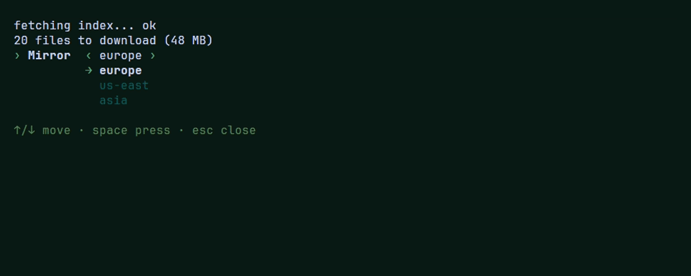

Source: [`examples/component/inline/main.go`](../examples/component/inline/main.go), which asks for a mirror, then yes or no, then draws a bar.

### Any form field

`inline.Ask` takes one field of [`form`](../component/form), asks for it the same way, and returns it, of its own type, as the user left it:

```go
region, err := inline.Ask(form.NewSelect("Region", []string{"europe", "us-east", "asia"}), th)
if errors.Is(err, inline.ErrAborted) {
	return nil // esc or ctrl+c
}
fmt.Println("deploying to", region.Value())
```

The same keys hold for every field:

- **enter** answers. A field that opens a list or a calendar (select, multiselect, date) opens at once, and enter there picks and answers in one press. In a tags field, enter adds what was typed, and an enter on nothing answers.
- **esc** cancels with `inline.ErrAborted`; while a list or calendar is open, it closes that first, leaving the value as it was.
- **ctrl+c** always cancels.
- Every other key is the field's own, the same as inside a form. The line under the question names them.

Once answered, the question gives way to one line, the label and the answer: `Region us-east`. The field comes back even on `ErrAborted`, as it was left.

The options after the theme reach the program: `tea.WithContext` cancels the question, and `tea.WithInput` and `tea.WithOutput` answer it in a test.

Each recording below is [`examples/component/ask`](../examples/component/ask/main.go) run with the field's name, `go run ./examples/component/ask select`: a line the CLI printed, the question, and a line with what it did with the answer.

#### Input

Typed text. `WithPlaceholder`, `WithWidth`, `WithFormat` and `WithMask` work as in a form.

```go
name, err := inline.Ask(form.NewInput("Name").WithPlaceholder("my-api").WithWidth(24), th)
```

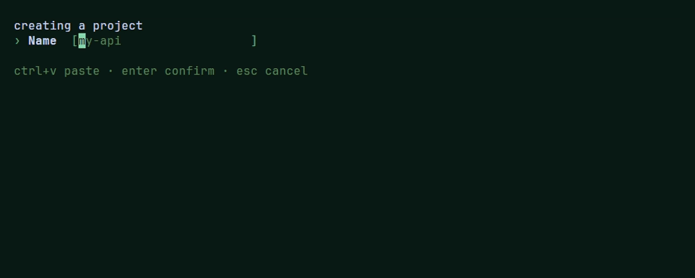

For a password or a token, `WithMask` draws each character as the rune given. `Value()` still returns the text; the line left once answered shows six stars instead, whatever its length, so the secret stays out of the scrollback:

```go
pw, err := inline.Ask(form.NewInput("Password").WithMask('•'), th)
// the terminal keeps "Password ******"; pw.Value() is the password
```

#### Select

One option out of a list, open from the start: the arrows move, enter picks. `WithDescriptions` writes a line beside each option.

```go
region, err := inline.Ask(form.NewSelect("Region", []string{"europe", "us-east", "asia"}), th)
```

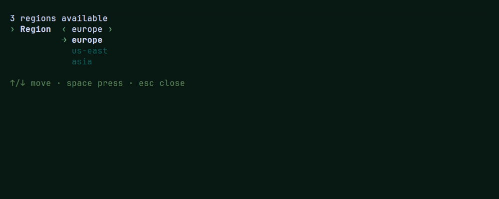

#### MultiSelect

Any number of options. Typing filters the list fuzzily, space checks the option under the cursor, ctrl+a checks every one the filter shows, enter answers. Read the result with `Values()` or `Checked()`.

```go
tools, err := inline.Ask(form.NewMultiSelect("Tools", []string{"git", "docker", "node", "golang", "python"}).WithHeight(5), th)
fmt.Println(strings.Join(tools.Values(), " "))
```

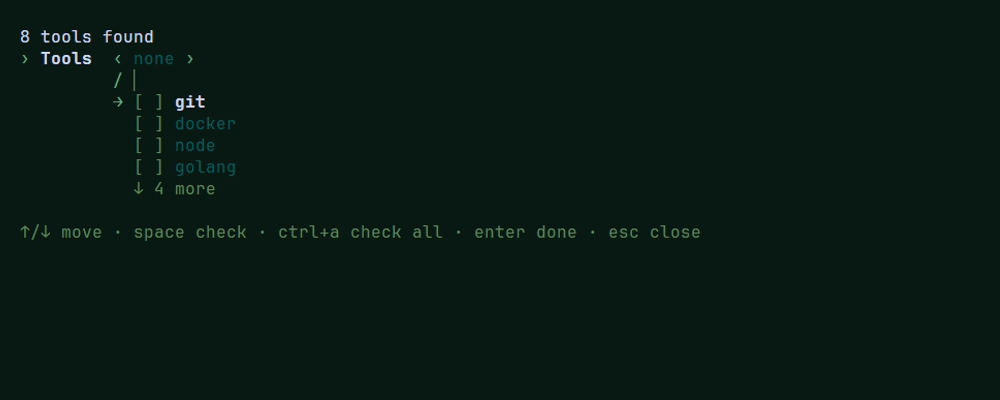

#### Radio

One of a few options laid out on one line, chosen with left and right.

```go
shell, err := inline.Ask(form.NewRadio("Shell", []string{"bash", "zsh", "fish"}), th)
```

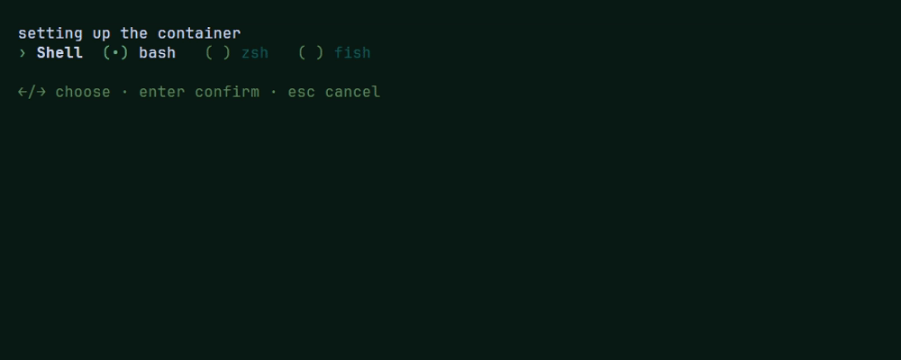

#### Checkbox

A box space ticks; enter answers without flipping it back. For a plain yes or no, `Confirm` reads better.

```go
start, err := inline.Ask(form.NewCheckbox("Start it now"), th)
if start.Checked() {
	// ...
}
```

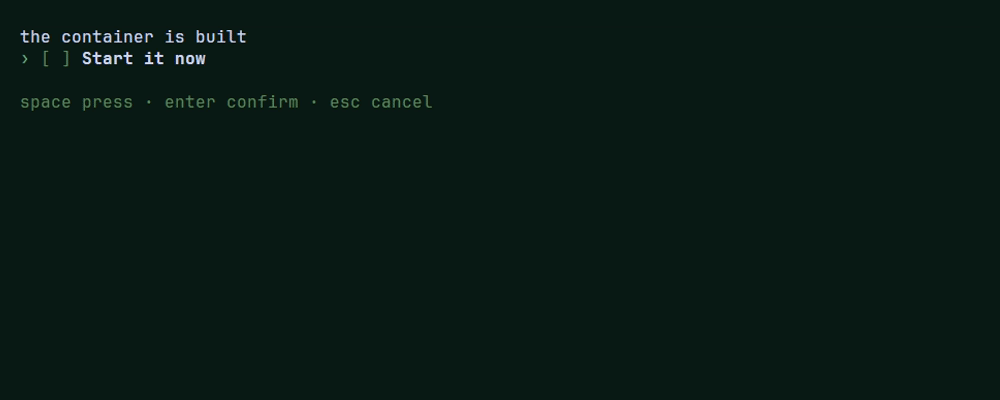

#### Toggle

An on/off switch, turned with left, right or space. `On()` reads it.

```go
telemetry, err := inline.Ask(form.NewToggle("Telemetry"), th)
```

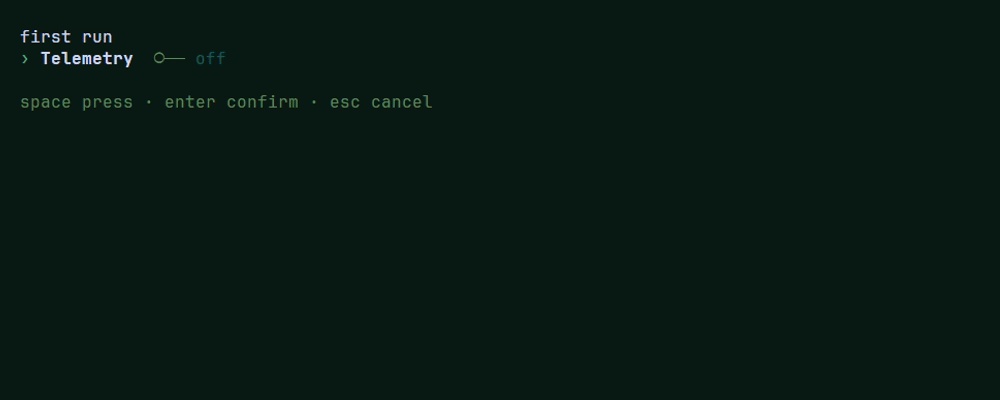

#### Number

A number up and down steps, digits type, kept inside `WithRange`.

```go
port, err := inline.Ask(form.NewNumber("Port", 8081).WithRange(1024, 65535), th)
```

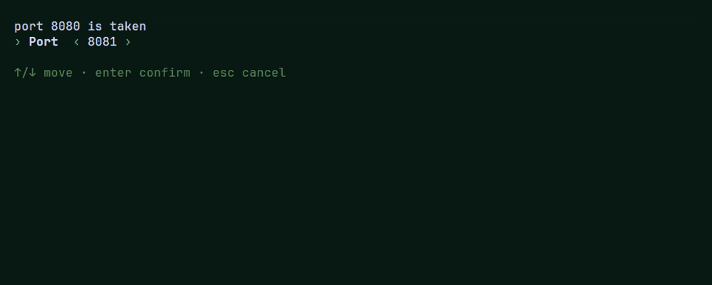

#### Slider

The same value as a bar, moved with left and right in `WithStep` steps.

```go
workers, err := inline.Ask(form.NewSlider("Workers", 4).WithRange(1, 8), th)
```

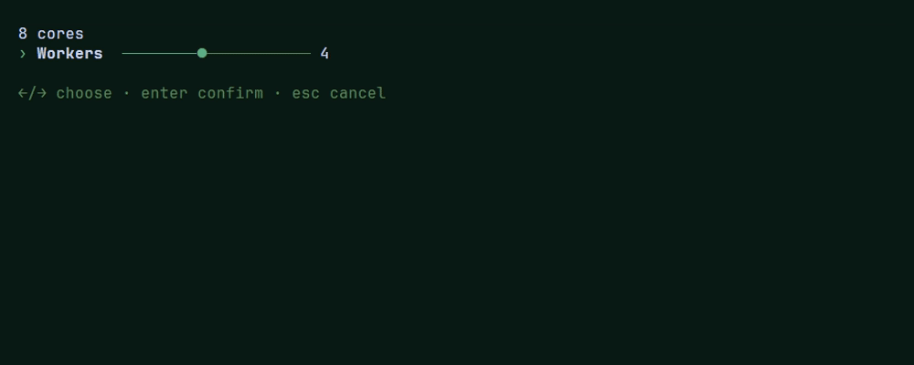

#### Date

A day picked from a calendar that opens at once: the arrows move by day and week, enter picks. `Day()` is the `time.Time`, `Value()` the day written in `WithFormat`'s layout.

```go
release, err := inline.Ask(form.NewDate("Release", time.Now()), th)
```

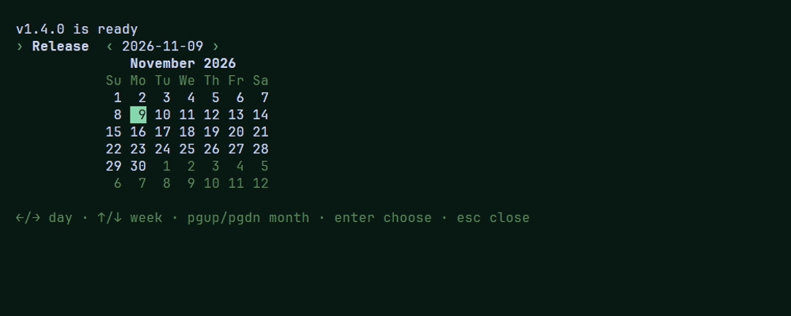

#### Tags

Text that becomes chips: enter adds one, backspace on nothing takes the last off, tab completes from `WithSuggestions`. An enter on nothing answers.

```go
labels, err := inline.Ask(form.NewTags("Labels").WithSuggestions([]string{"bug", "docs", "feature"}), th)
fmt.Println(labels.Tags())
```

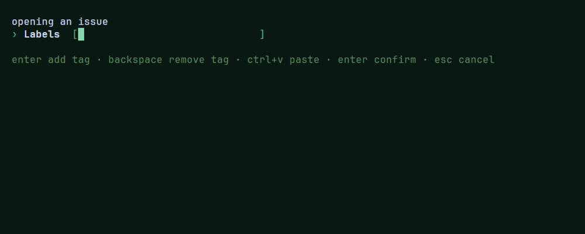

A button asks nothing on its own, so it is the one field `Ask` has no use for.

### Without a terminal

A question needs someone at a keyboard. When stdout or stdin is redirected, `cli > out.txt` or `cat list | cli`, `Confirm` and `Ask` open the terminal itself and ask there, so the question stays out of the file and the keys still reach it. Where no terminal opens at all, as in a CI job or a cron task, they return `inline.ErrNoTerminal` at once instead of waiting for keys that cannot come, and the app falls back to a flag or a default:

```go
region, err := inline.Ask(form.NewSelect("Region", regions), th)
switch {
case errors.Is(err, inline.ErrNoTerminal):
	return fmt.Errorf("no terminal to ask on: pass --region")
case errors.Is(err, inline.ErrAborted):
	return nil
case err != nil:
	return err
}
```

On Windows a process that has a console, even a hidden one, can always open it, so there the question waits instead. For a run nobody watches, bound it with `tea.WithContext` and a deadline: when it passes, the question returns `tea.ErrProgramKilled`.

## Output

### Progress

The functions of [`progress`](../component/progress) return one line of text; `\r` before each redraws it in place:

```go
for i, f := range files {
	move(f)
	fmt.Print("\r" + progress.Line("moving", i+1, len(files), 60, th))
}
fmt.Println()
```

`Bar` is the bar alone, `Meter` a row of squares, `Smooth` a bar cut to eighths of a cell, `Stepper` the stages of a run with the current one marked. The [inline recording](#yes-or-no) above ends on a `Bar`.

### Tables and trees

`table.Static` and `tree.Static` return the whole thing as text, ready for `fmt.Println`. There's no cursor and no scrolling; for that, use the `Model` in each package.

```go
cols := []table.Column{{Title: "NAME", Flex: true}, {Title: "STATUS"}}
rows := [][]string{{"api", "running"}, {"worker", "stopped"}}
fmt.Println(table.Static(cols, rows, 80, th)) // 0 keeps each column's own width

fmt.Println(tree.Static([]tree.Branch{{Text: "app", Children: []tree.Branch{
	{Text: "cmd", Children: []tree.Branch{{Text: "main.go"}}},
	{Text: "go.mod"},
}}}, th))
```

```text
NAME    STATUS
api     running
worker  stopped

app
├─ cmd
│  └─ main.go
└─ go.mod
```

Which one to use:

| You want to | Use | It needs |
| --- | --- | --- |
| show a result and move on, as `ls` does | `table.Static`, `tree.Static` | nothing: it returns a string |
| let the user move, filter and choose | `table.New`, `tree.New` | a Bubble Tea program: a pane of the [frame](FRAME.md) or a model of your own that calls `Update` and `View` |

```go
// interactive: inside your model
m.tbl = table.New(cols, []table.Item[string]{
	{Cells: []string{"api", "running"}, Value: "api"},
}).SetHeight(10).SetWidth(60)

var r bezel.Result
if m.tbl, r = m.tbl.Update(msg); r.Handled {
	if c, ok := r.Event.(table.Chosen[string]); ok {
		_ = c.Item.Value // the row chosen with enter
	}
}
```

[CONVENTIONS.md](CONVENTIONS.md#static-and-interactive) has the rule behind the names.

### Logs

[`logger`](../component/logger) is a `slog.Handler`: each message on its line, every attribute hanging under it as a branch of a tree, a long value wrapped at the terminal's width.

```go
log := slog.New(logger.New(os.Stderr, th))
log.Info("moved", "files", 12, "to", "./cache")
```

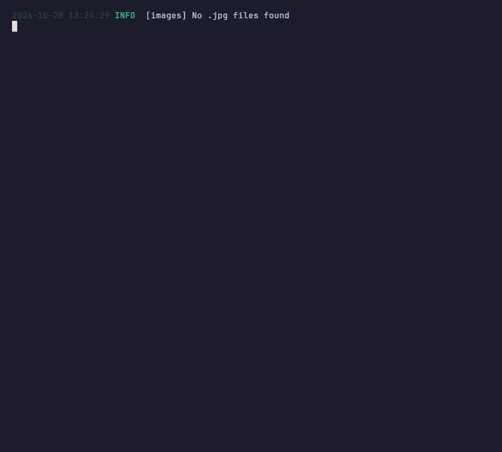

The tree is for a person reading a terminal. When the lines go to a pipe, a file or a log collector, hand the same calls to slog's own JSON handler instead: only the handler changes, never a `log.Info`. `logger.ReplaceAttr` names `logger.LevelTrace` "TRACE" there, where slog would print "DEBUG-4":

```go
var h slog.Handler = logger.New(os.Stderr, th)
if *asJSON { // a --json flag
	h = slog.NewJSONHandler(os.Stderr, &slog.HandlerOptions{Level: logger.LevelTrace, ReplaceAttr: logger.ReplaceAttr})
}
log := slog.New(h)
log.Info("moved", "files", 12, "to", "./cache")
```

```json
{"time":"2026-11-09T22:41:07.512-03:00","level":"INFO","msg":"moved","files":12,"to":"./cache"}
```

A flag lets the user choose; a CLI can also choose for them, the tree when stderr is a terminal and JSON when it is not.

Source: [`examples/component/logger/main.go`](../examples/component/logger/main.go)

### Themes

[`themebrowser`](../component/themebrowser) is what a `--list-themes` flag prints: `BrowseInTerminal` draws a table of the presets and their colours, `/` filters it and enter copies a name, and in a pipe it writes `List`'s plain lines instead.

```go
if err := themebrowser.BrowseInTerminal(theme.Default()); err != nil {
	return err
}
```

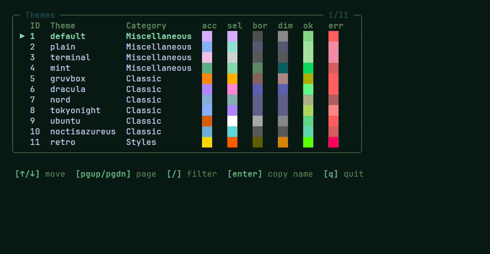

Source: [`examples/component/themebrowser/main.go`](../examples/component/themebrowser/main.go)
