# Components

One small program per package, each with a recording of it running; `bezeltest`, a helper for tests, has a test instead. Every GIF is a real session of its program, recorded from the `.tape` beside it in [`docs/recordings`](recordings). Run any of them with `go run ./examples/<group>/<name>`, as `go run ./examples/component/list`; for a small app that puts several together, `go run ./examples/app`, explained step by step in [EXAMPLE.md](EXAMPLE.md).

The widgets that go inside the panes live under [`component`](../component); the frame around them, and the key presses for tests, sit at the root. The effects have [EFFECTS.md](EFFECTS.md) and the animations [ANIMATIONS.md](ANIMATIONS.md).

## The frame

How these fit together, from the first `shell.Config` to a dialog of your own, is [FRAME.md](FRAME.md).

What every screen is built in: the shell an app embeds, the layout it resolves, the theme it draws with, and the dialogs, legend and command line around the panes.

### Shell

Source: [`examples/frame/shell/main.go`](../examples/frame/shell/main.go)

Two tabs and two panes. `s` sets a status that clears itself, `b` shows the busy spinner until the work is done, `d` asks before deleting, `tab` switches tab and `?` lists every key. The mouse works as well: a click on a tab shows it, on a pane focuses it, on a row moves the cursor there (a second click opens it), and on a dialog's button presses it.


### Layout

Source: [`examples/frame/layout/main.go`](../examples/frame/layout/main.go)

A header over two columns, each pane printing the rect it was given. `w` narrows the window below the `Collapse` limit and the side column drops out, then comes back.

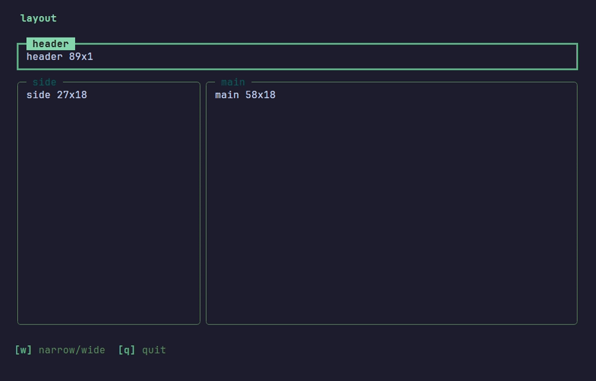

### Theme

Source: [`examples/frame/theme/main.go`](../examples/frame/theme/main.go)

Every colour role and a list drawn with it. `n` and `p` step through a few presets, and `SetTheme` swaps them on the running shell.

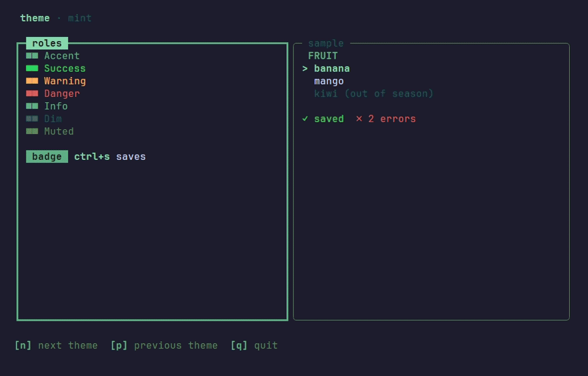

### Overlay

Source: [`examples/frame/overlay/main.go`](../examples/frame/overlay/main.go)

The ready-made modals, one per row: an alert, a confirm that answers the app, a prompt that refuses an empty name, the help list, a pager over a command's output and a file picker. `enter` opens the one under the cursor and `esc` closes it.


### Draw

Source: [`examples/frame/draw/main.go`](../examples/frame/draw/main.go)

One scrolling pane with a section per helper: header, tabs, breadcrumb, dividers, a card with its actions in the footer, buttons, key-value rows, wrapped and truncated text, numbered lines and the empty state.

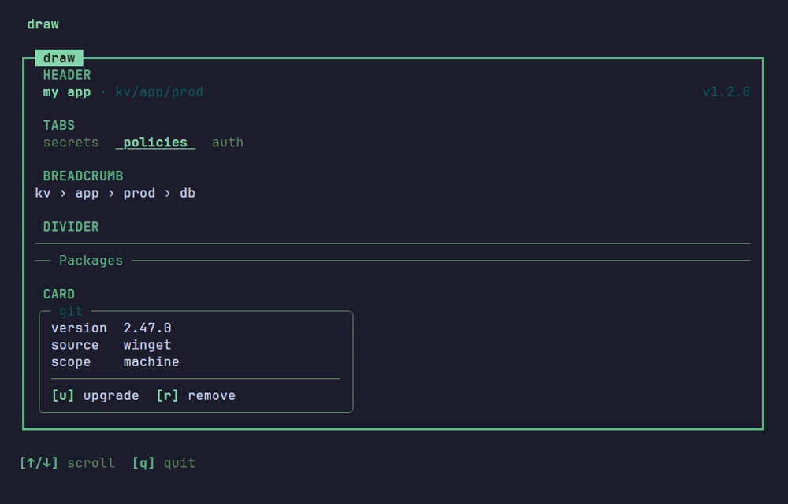

### Legend

Source: [`examples/frame/legend/main.go`](../examples/frame/legend/main.go)

More keys than one row holds: the ones cut are counted and `?` lists them all. Five keys need a write capability; `w` grants it and they join the legend.

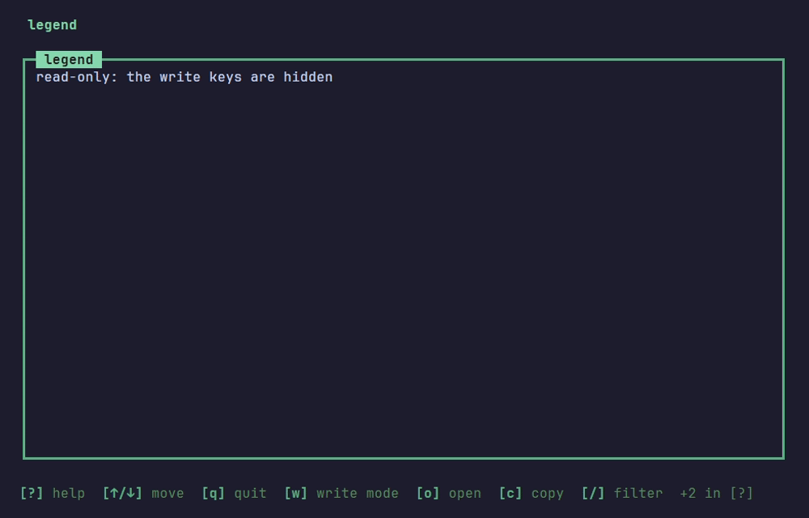

### Palette

Source: [`examples/frame/palette/main.go`](../examples/frame/palette/main.go)

The `:` command line. A name completes with `tab`, a command takes an argument, and one that is unknown or not allowed says so on the status row.

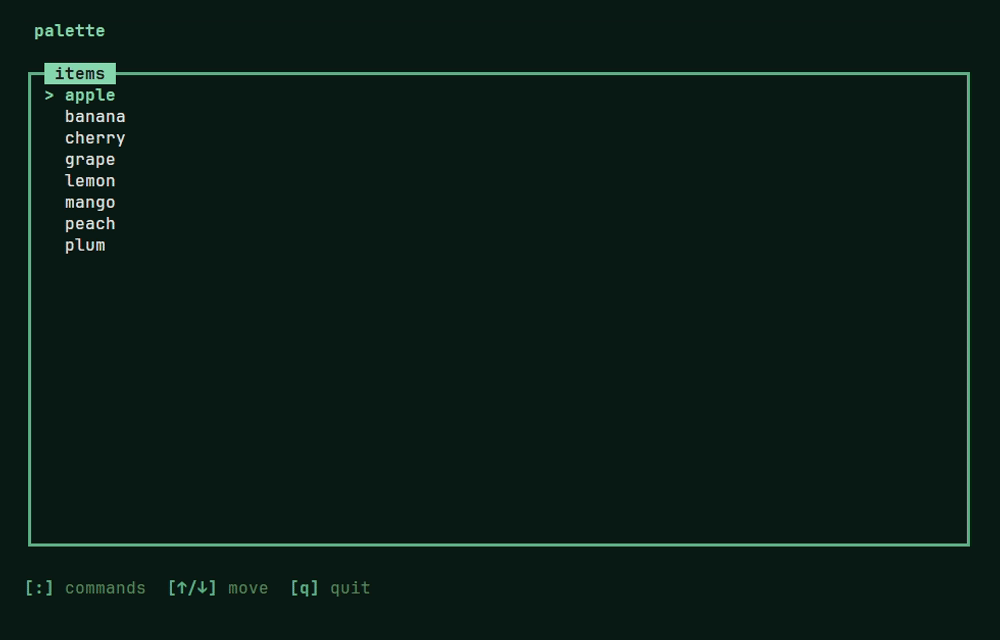

## Lists, tables and text

What a pane shows: rows with a cursor, a tree, a table, pages of items, a long text to scroll, and a list beside its detail.

### List

Source: [`examples/component/list/main.go`](../examples/component/list/main.go)

Rows under section headings the cursor skips, `enter` showing the payload a row carries, and a `/` filter that takes every key, `q` included. `WithMotion` makes the cursor glide from row to row, a row that arrives light up and one that leaves fade where it was; `Update` starts the motion and takes its frames, so the app hands it every message.

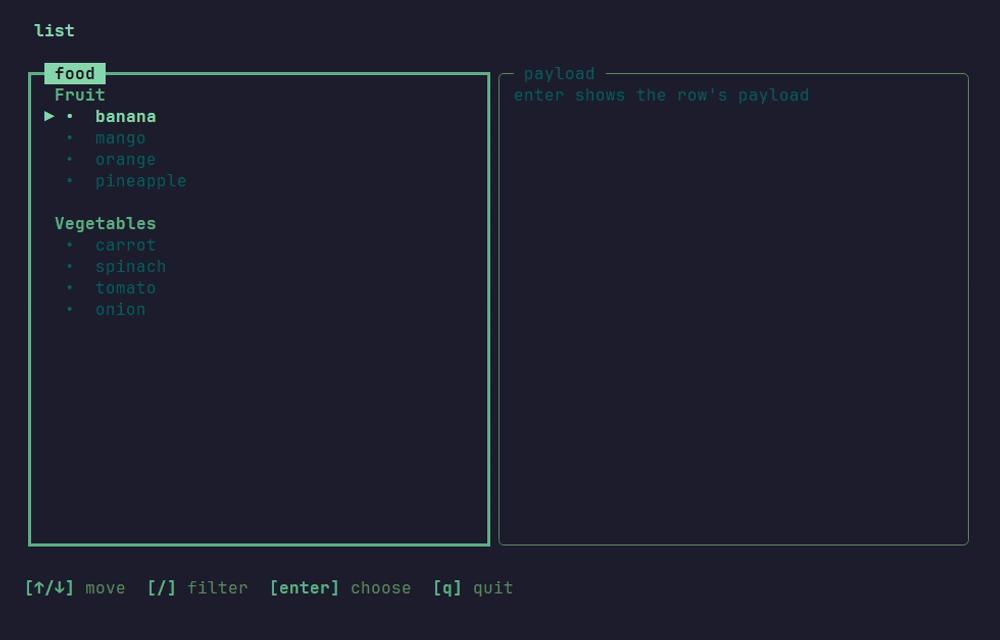

### Paginator

Source: [`examples/component/paginator/main.go`](../examples/component/paginator/main.go)

Forty-two items, eight to a page, with the page under them. `←` and `→` turn the page, as do `pgup`/`pgdown` and `h`/`l`, and `t` switches between "2/6" and a row of dots.

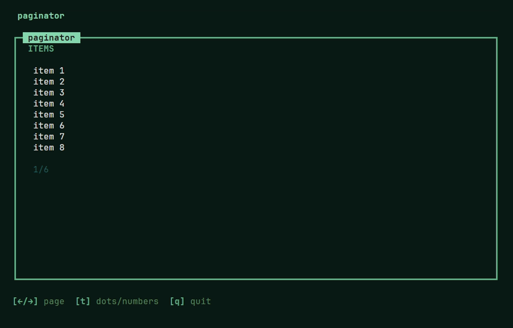

### Filepicker

Source: [`examples/component/filepicker/main.go`](../examples/component/filepicker/main.go)

The repository browsed inside a pane, directories first and sizes in a column. `enter` opens a directory or picks a file and names it on the status row, `←` climbs, and `p` shows or hides the permissions column.

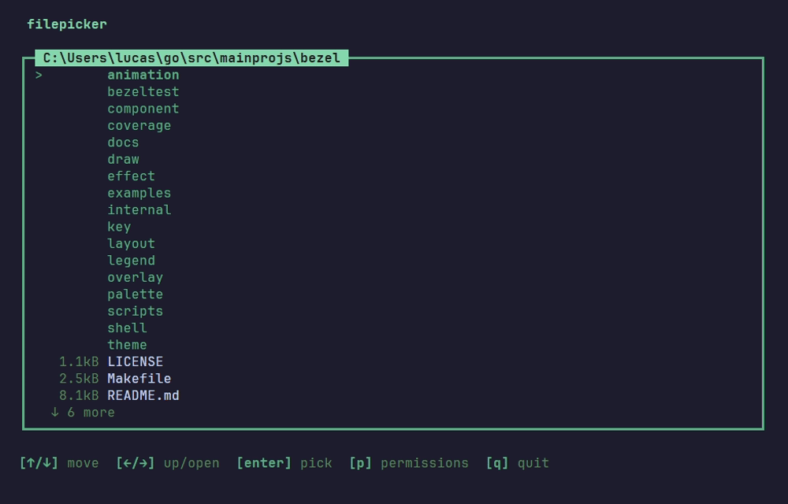

### Tree

Source: [`examples/component/tree/main.go`](../examples/component/tree/main.go)

A directory tree over the app's own node type. The arrows expand and collapse; `:reveal` opens every parent on the way down to a path.

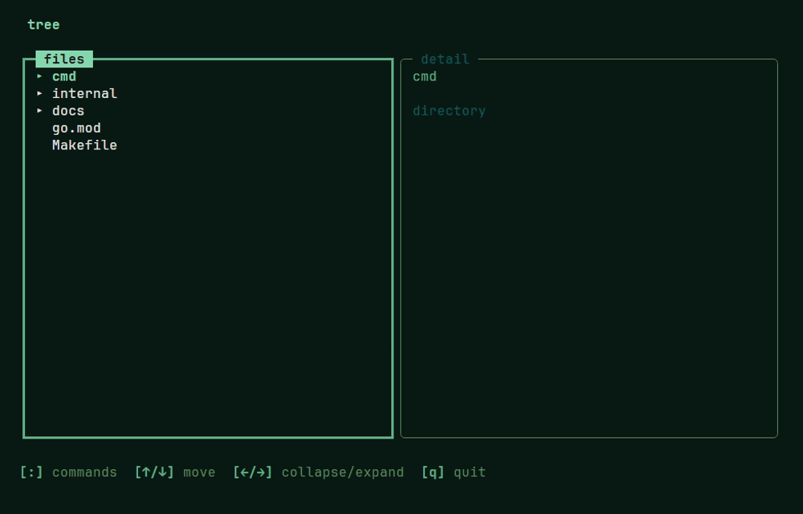

### Table

Source: [`examples/component/table/main.go`](../examples/component/table/main.go)

Columns sized to their contents, and a cursor over rows that scroll under a fixed header, with the position at the foot of the pane, a scrollbar down its edge and the row's detail below. `pgdown` and `pgup` move a page at a time, `enter` reports the chosen row, and `w` narrows the window: the description gives way first, and the version and licence stay whole.


### Viewport

Source: [`examples/component/viewport/main.go`](../examples/component/viewport/main.go)

An access log, numbered in a gutter, with its error lines in red and every `ERROR` highlighted. The arrows, `pgup`/`pgdown` and `home`/`end` scroll, `←` and `→` pan the long lines, `n` and `N` go from error to error, `w` wraps the lines, and the mouse wheel scrolls.

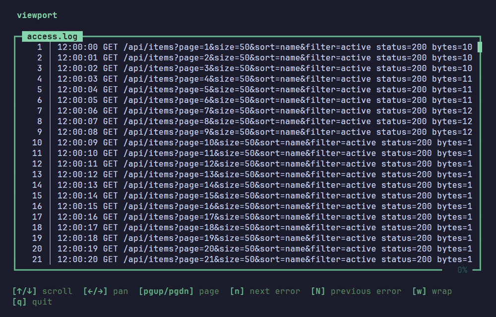

### Browser

Source: [`examples/component/browser/main.go`](../examples/component/browser/main.go)

Recipe names on the left, the selected recipe on the right. `tab` moves the keys to the recipe so it scrolls, and back.

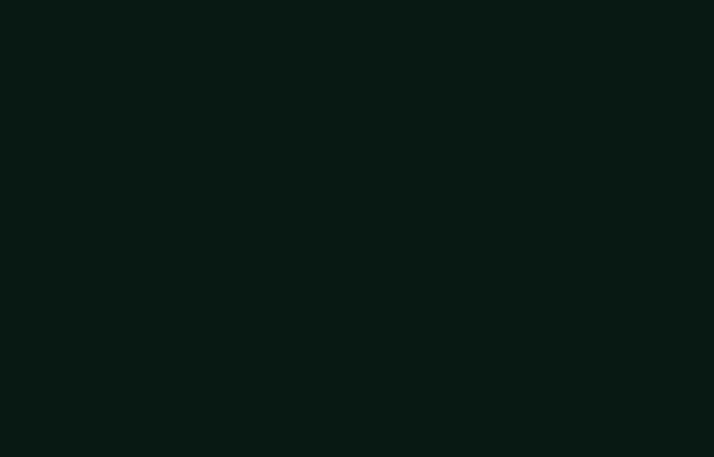

### Accordion

Source: [`examples/component/accordion/main.go`](../examples/component/accordion/main.go)

A column of questions, each a heading that opens onto its answer, sliding rather than jumping. The arrows move between headings and `enter` or `space` opens and closes the one under the cursor; a section closing half way closes from where it is.

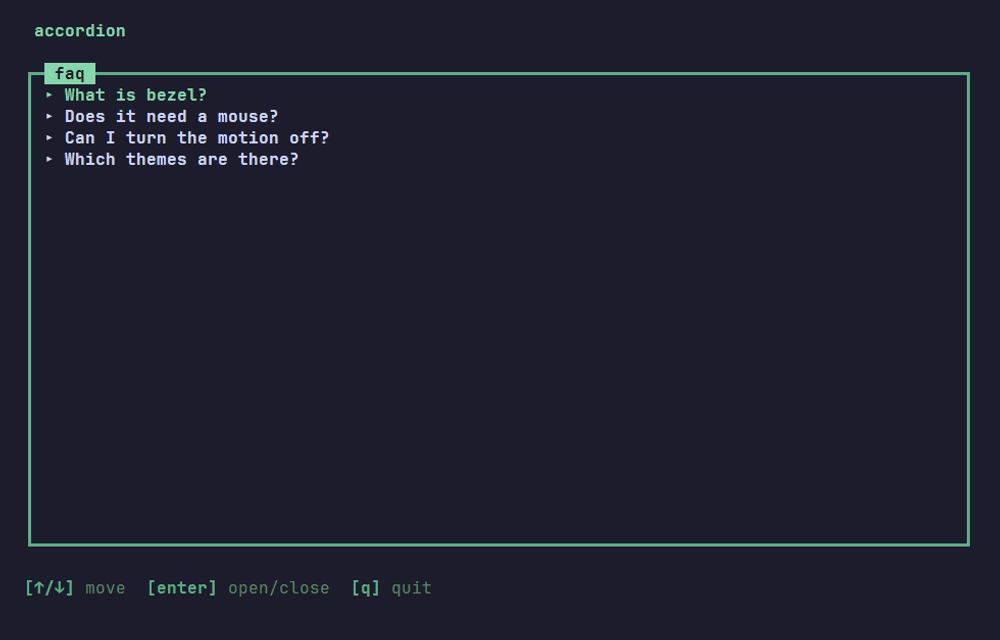

## Input

What the user types into: a form of controls, a one-line field, a multi-line field, and the caret any field of your own can draw.

### Form

Source: [`examples/component/form/main.go`](../examples/component/form/main.go)

One of each control: a name typed into an `Input`, an image picked from a `Select` that opens under it, a `Radio`, a `Toggle` and a `Checkbox`, then the `Button` that submits. `tab` and `shift+tab` move between them; Create reports the values on the status row.

```go
f := form.New(th,
	form.NewInput("Name").WithPlaceholder("my-project").WithWidth(28),
	form.NewSelect("Image", []string{"ubuntu", "debian", "alpine"}),
	form.NewToggle("Docker").WithOn(saved.Docker),
	form.NewButton("Create", create),
)
// Init starts the caret of the input the form opens on.
func (m model) Init() tea.Cmd { return m.form.Init() }
```

The form paints every control in its theme, and `SetTheme` repaints them all.


### Input

Source: [`examples/component/input/main.go`](../examples/component/input/main.go)

Three one-line fields. The name must not be empty, and says so once you leave it blank; the command completes on `tab` from its suggestions; the password shows only its mask. `↑/↓` move between them and `enter` submits. Every key is text, so the app quits on `esc`.

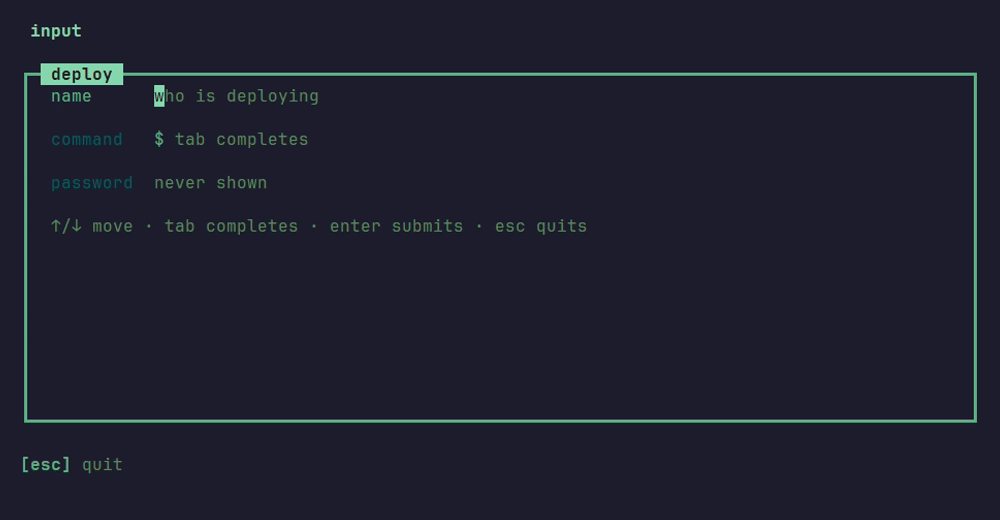

### Textbox

Source: [`examples/component/textbox/main.go`](../examples/component/textbox/main.go)

A multi-line value with its lines numbered. Every key is text, so the app quits on `esc`; `ctrl+s` counts the lines. Shift with the arrows selects, and so does dragging the mouse: the press comes as a `shell.ClickMsg`, the drag through the shell's `MouseIn`.

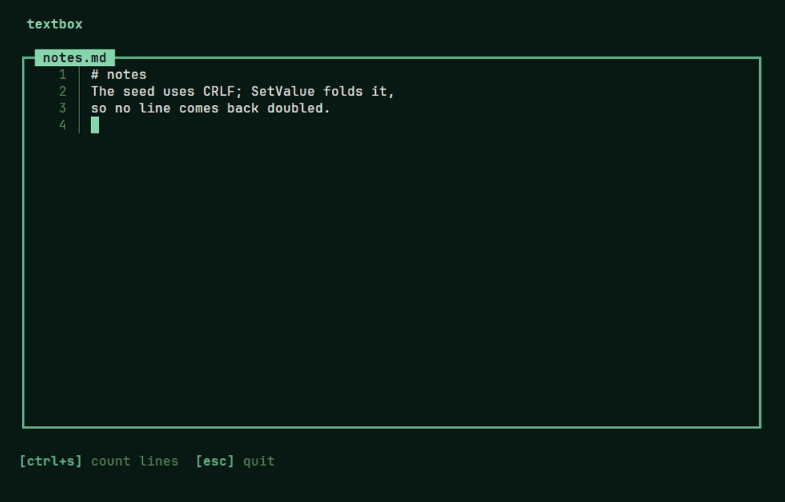

### Cursor

Source: [`examples/component/cursor/main.go`](../examples/component/cursor/main.go)

Three cursors, one per mode, each on the first letter of a word. `tab` moves the focus down the rows, and `m` turns the focused cursor from blinking to steady to hidden and around again.

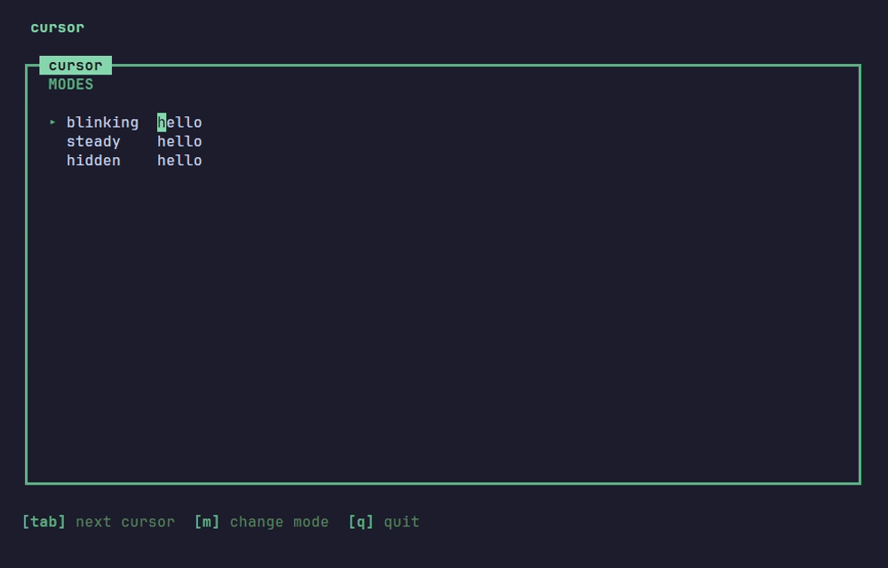

## Progress, time and state

How far along something is, how long it took, what state it is in, and a run of numbers charted.

### Progress

Source: [`examples/component/progress/main.go`](../examples/component/progress/main.go)

A count that fills on its own, as a `Line` and as a bare `Bar`, and a wizard's stages in a `Stepper`. `n` and `p` walk the stages; the copy drawn at 30 columns folds to "Step 2 of 4". `r` restarts the count.

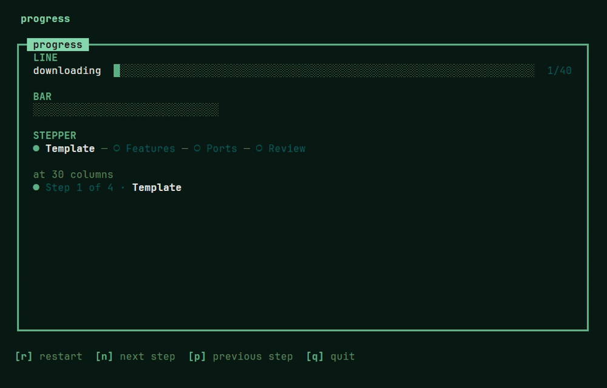

### Chart

Source: [`examples/component/chart/main.go`](../examples/component/chart/main.go)

A made-up CPU load fed a sample per tick, drawn as an `Area` and a `Spark` line, beside labelled `Bars` (the busy ones in the danger colour), a week's `Heat` grid and a `Donut`. `space` pauses the feed and `r` starts it over.

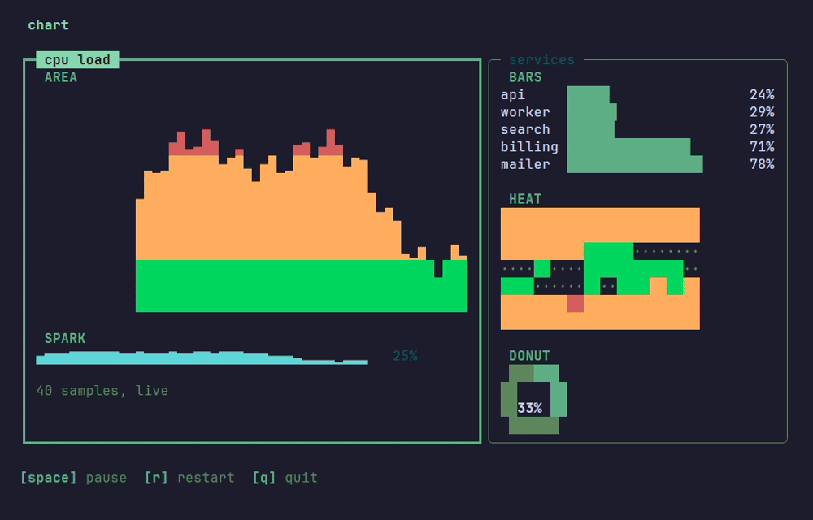

### Spinner

Source: [`examples/component/spinner/main.go`](../examples/component/spinner/main.go)

The twelve presets side by side, each turning at its own pace. `space` stops them all and starts them again.

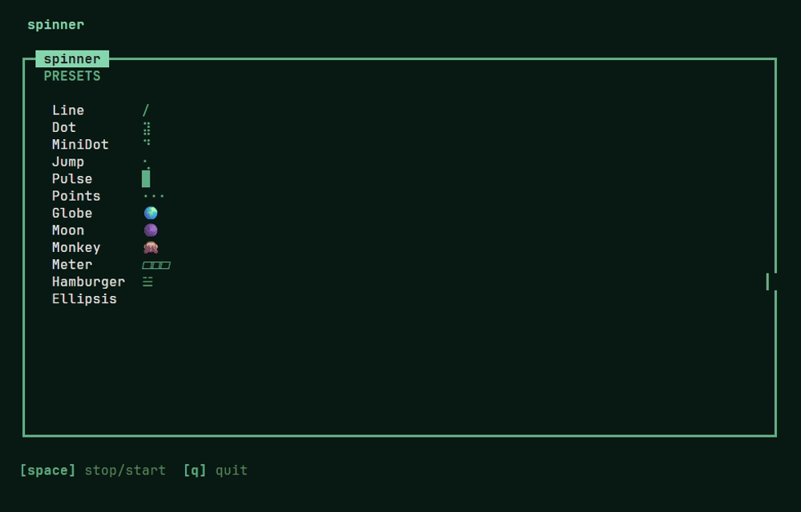

### Timer

Source: [`examples/component/timer/main.go`](../examples/component/timer/main.go)

Ten seconds counted down a tenth at a time, written to a tenth with `WithFormat`. `space` stops and resumes it, `r` starts it over, and the status row says when time is up.

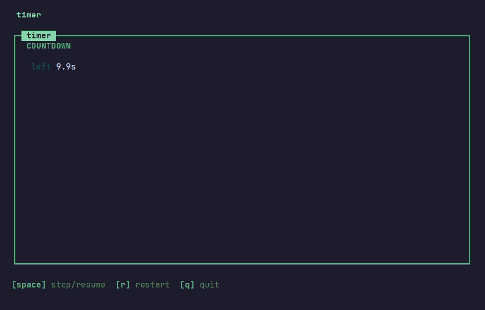

### Stopwatch

Source: [`examples/component/stopwatch/main.go`](../examples/component/stopwatch/main.go)

Time counted up a tenth at a time. `space` starts and stops it, and `r` puts it back to zero, running or not.

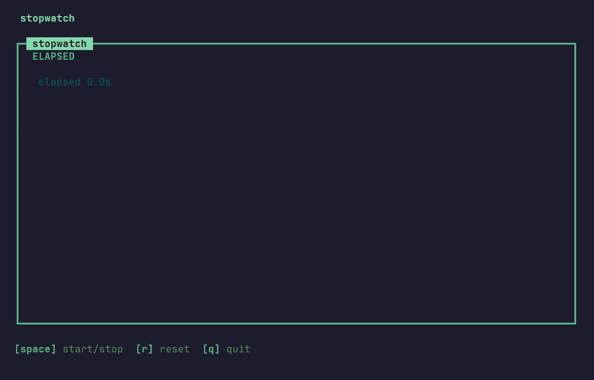

### Icon

Source: [`examples/component/icon/main.go`](../examples/component/icon/main.go)

Every state mark in both sets, then a list of packages and a source chain drawn as a tree. `a` swaps them between Unicode and ASCII, the set `BEZEL_ASCII` or `TERM=dumb` picks on its own.

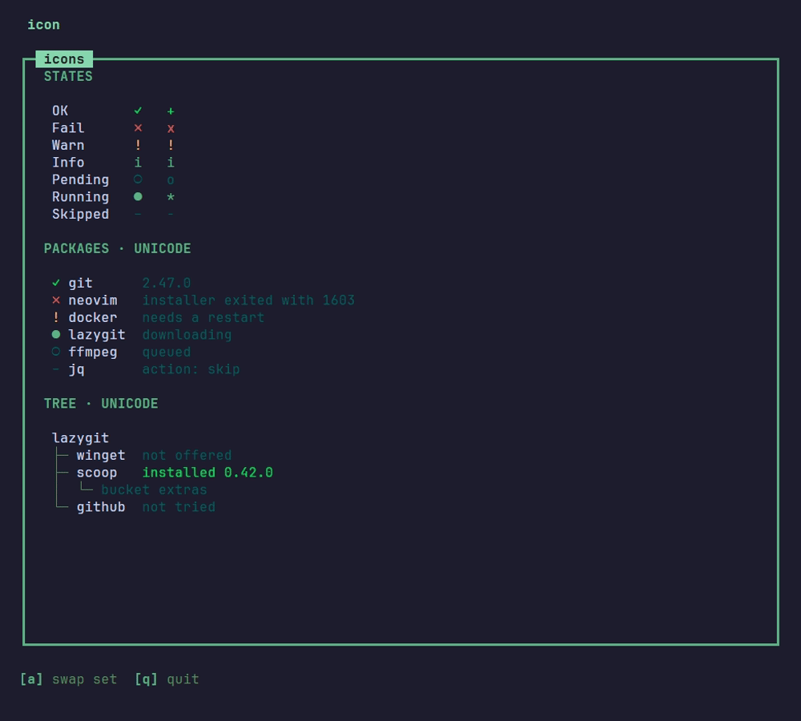

### Toast

Source: [`examples/component/toast/main.go`](../examples/component/toast/main.go)

Notices that slide into the top right corner, stack with the newest on top, and leave on their own after three seconds, each edged in the colour of its kind. `Over(screen, th)` draws them on top of whatever the shell drew. `s`, `c`, `w` and `e` push one of each kind.

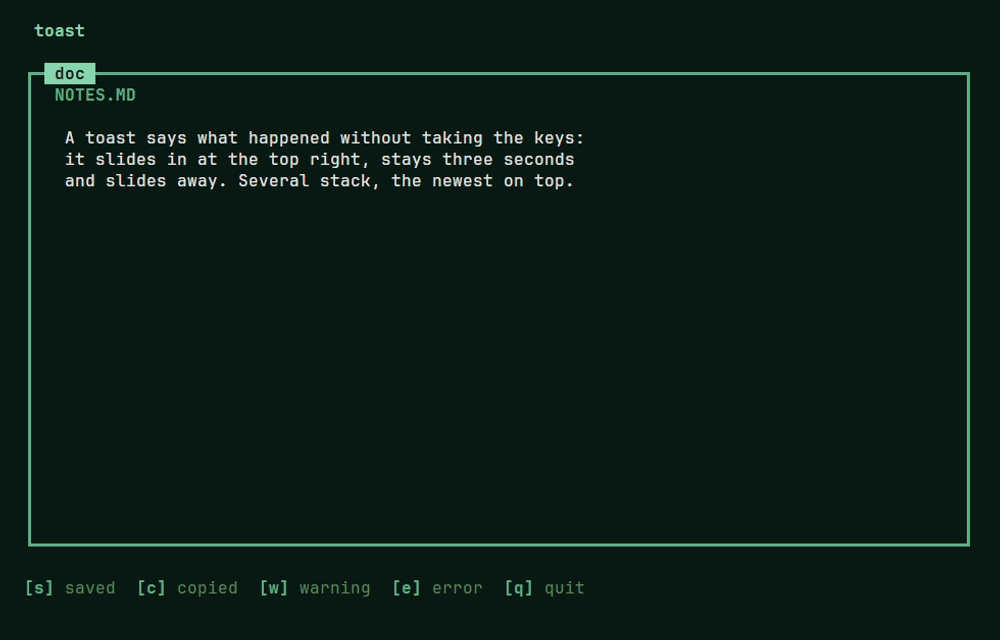

## Outside a full screen

For a CLI that prints logs rather than takes the screen, and for the tests that drive a model.

### Inline

Source: [`examples/component/inline/main.go`](../examples/component/inline/main.go)

A CLI that prints logs, asks one question below them, then redraws a progress bar in place. Nothing takes over the screen.

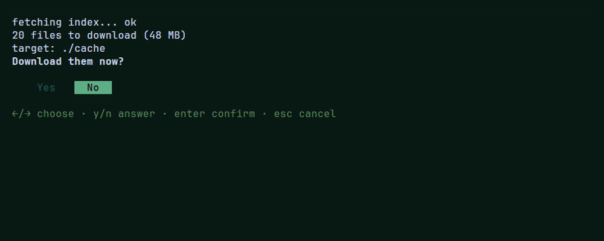

### Logger

Source: [`examples/component/logger/main.go`](../examples/component/logger/main.go)

A run that sorts downloads, logged through `log/slog`. Each message gets its own line and every attribute hangs under it as a branch of a tree, groups as nested branches; a long path wraps under its own start instead of being cut. `--json` sends the same calls to slog's JSON handler.

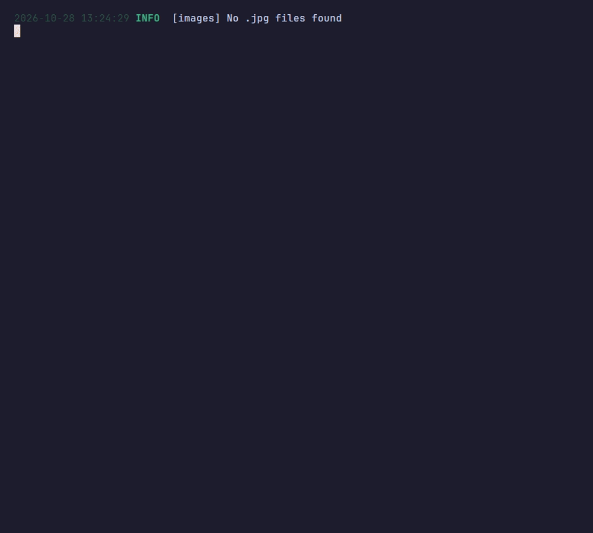

### Themebrowser

Source: [`examples/component/themebrowser/main.go`](../examples/component/themebrowser/main.go)

The table a `--list-themes` flag prints: as wide as the terminal, each colour named, `/` to filter and `enter` to copy a theme's name; plain lines in a pipe.

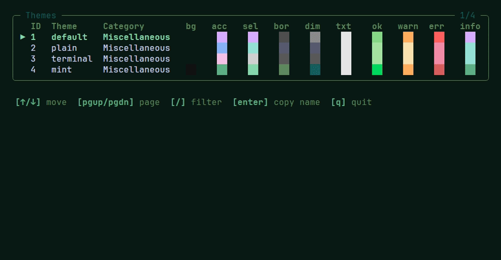

### Bezeltest

Source: [`examples/frame/bezeltest/main_test.go`](../examples/frame/bezeltest/main_test.go)

No recording: this one is a test. A counter, and the test that drives it with the key presses a terminal would send.

## Changing the keys

Every component that answers to keys keeps them in a struct of [`key.Binding`](../key)s. Packages with one component call it `Keys`: `list`, `tree`, `table`, `browser`, `viewport`, `input`, `textbox`, `form`, `accordion`, `paginator`, `filepicker`, `palette`. In `overlay`, each dialog has its own: `ConfirmKeys`, `PickKeys`, `PromptKeys`, `PagerKeys`, `HelpKeys`, `FilePickerKeys`. `DefaultKeys()` (or `DefaultConfirmKeys()` and so on) builds the defaults, and `WithKeys` hands the component a new set. Start from the defaults and change only what you need:

```go
k := list.DefaultKeys()
k.Up = key.New("up", "k").WithHelp("↑/↓ k/j", "move")
k.Down = key.New("down", "j")
k.Filter.Disabled = true // no filtering here
l := list.New(rows).SetHeight(10).WithKeys(k)
```

- **The legend follows.** A component's `Legend` is built from the same bindings it matches against, so a new key or new help shows up in the legend with nothing else to change. A disabled binding stops matching and drops out of the legend.
- **A pair shows as one entry.** In `Up`/`Down`, `PageUp`/`PageDown` and the like, the first binding carries the help for both, and the second has none and stays out of the legend. Keep it that way when you rebind them, as `k.Down` does above.
- **No default takes a letter.** Every `DefaultKeys` is the arrows, pgup/pgdown, home/end and named keys, so a letter is never taken from the app. Vim's letters are a preset beside the defaults, handed in through the same `WithKeys`; their help names the letters, so the legend follows:

  ```go
  l := list.New(rows).WithKeys(list.VimKeys())            // k/j, g/G, ctrl+b/f
  vp := viewport.New().WithKeys(viewport.VimKeys())       // and h/l, ctrl+u/d
  f := form.New(th, fields...).WithKeys(form.VimKeys())   // h/l and k/j in the controls
  p := overlay.NewPick(title, rows, onPick, th).WithKeys(overlay.VimPickKeys())
  ```

  `VimKeys()` is in `list`, `tree`, `table`, `browser`, `accordion`, `viewport`, `paginator`, `filepicker` and `form`; `overlay` has `VimPickKeys`, `VimFilePickerKeys` and `VimPagerKeys`. A preset is a starting point like the defaults: change one binding of it as above. Where a field is typed into (`input`, `textbox`, `palette`, a list's filter prompt) letters stay text.

- **A form takes one set.** `form.Keys` covers the form and every control in it, and `Form.WithKeys` rebinds all of them at once.
- **Esc belongs to the overlay stack.** The stack closes the top dialog before the dialog sees esc, so rebinding a dialog's esc only matters when you drive the dialog without a stack.

The frame's own keys are not a struct. Each one is a [`shell.Action`](FRAME.md#actions), so the app picks the key when it builds the action, `WithKey` adds more keys under the same label, and one definition covers the key, the legend, the help and the `:` palette.

## Recording

The tapes live in `docs/recordings`, beside the GIFs they make, and are written for Windows: each sets `Set Shell "powershell"`, builds a `.exe` off camera and deletes it when done. Every example also starts and quits off camera, so its GIF opens and loops on the program; the three that print into the terminal rather than take it over, `inline`, `logger` and `themebrowser`, run behind a `clear` so their command line never shows. The galleries, of animation, text, scenes and effects, have a tape per tab. They draw 1000 px wide in JetBrainsMono Nerd Font at 16px, so GitHub shows them close to full size, and 640 px tall unless the example needs another height. With [VHS](https://github.com/charmbracelet/vhs), `ttyd` and `ffmpeg` on the `PATH` and the font installed, from the repository root:

```sh
vhs docs/recordings/component/list.tape
```

From the root, always: `Output` resolves against the working directory, not against the tape. Without the font, VHS falls back to another monospace and the recording drifts from the others.
