# Effects

The [`effect`](../effect) package changes a block that is already drawn. Its gallery has a tab for each family below:

```sh
go run ./examples/effect
go run ./examples/effect --effect melt   # one effect on its own
```

## Over a drawn block

`Apply` reads the block's escape codes back into cells, turns each one and draws it again, the same size, so it works on whatever a `View` returns, a pane, a dialog or a whole screen:

```go
body := m.card.View()
if m.reveal.Active() {
	body = m.reveal.Apply(body)
}
```

| Effect | What it does |
| --- | --- |
| `FadeIn`, `FadeOut` | raises every cell's colours from a colour to its own, or sinks them into one |
| `Dissolve`, `Coalesce` | blanks the cells one by one, or gathers the block out of nothing |
| `SweepIn` | reveals the block behind a tinted front |
| `SlideIn`, `SlideOut` | moves the block in or out whole, from or to an edge |
| `Evolve` | grows each cell out of `░▒▓█` into its own character |
| `Explode` | throws the cells outward from the middle |
| `Expand`, `Stretch` | opens the block from its middle, or fills it from an edge in eighths of a cell |
| `HueShift`, `Saturate` | turns the colours round the wheel, or drains or deepens them |

### FadeIn

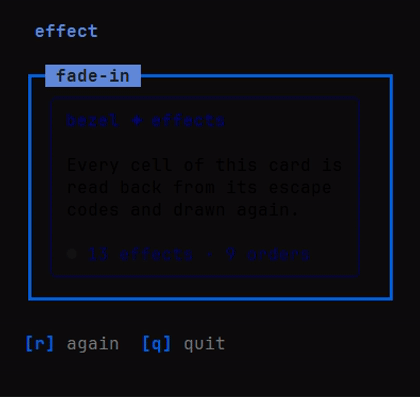

### FadeOut

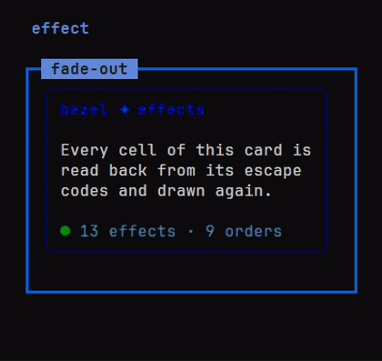

### Dissolve

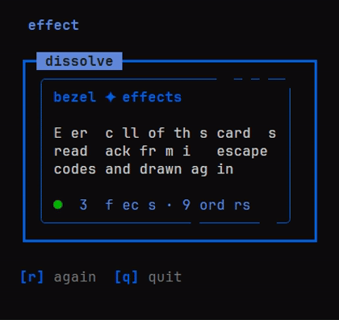

### Coalesce

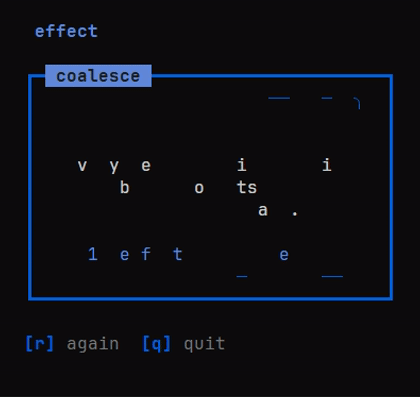

### SweepIn

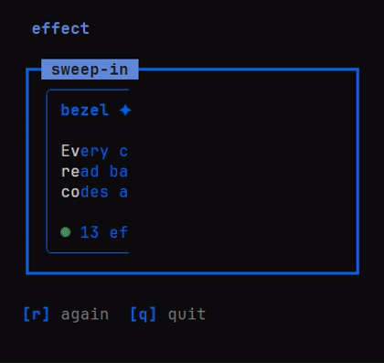

### SlideIn

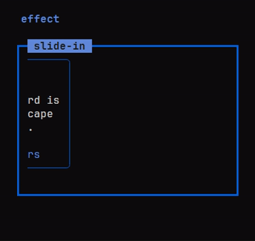

### SlideOut

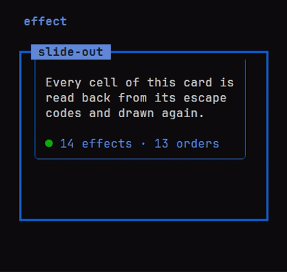

### Evolve

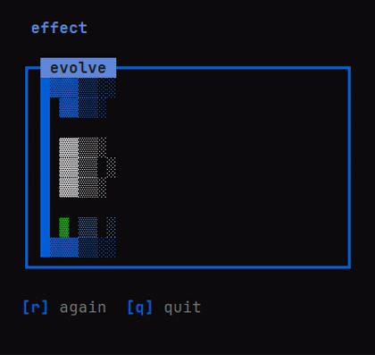

### Explode

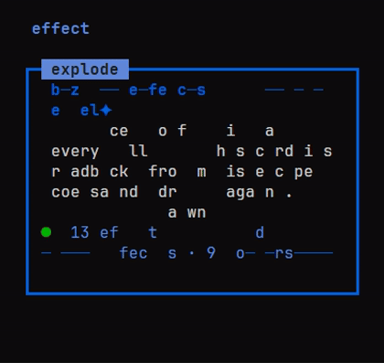

### Expand

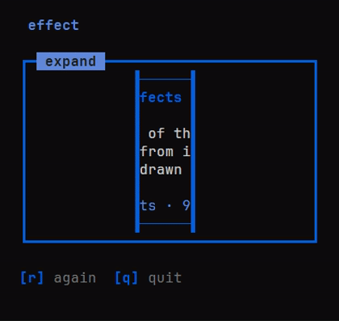

### Stretch

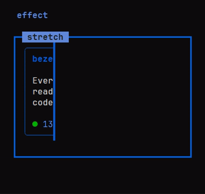

### HueShift

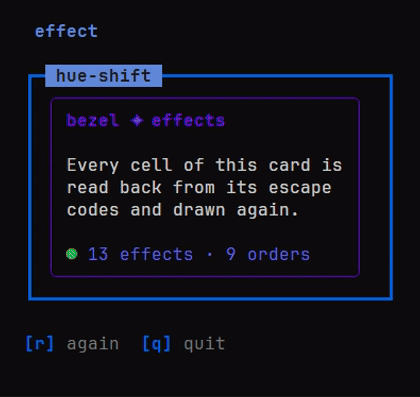

### Saturate

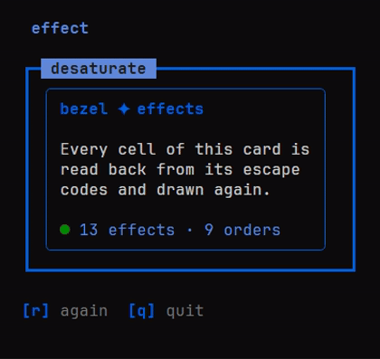

### Cascade

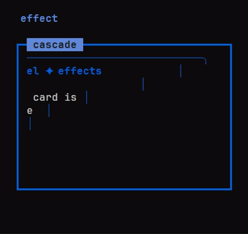

Most take a `Pattern`, the order the cells turn in: `Sweep`, `Radial`, `RadialFrom(x, y)`, `Diamond`, `Diagonal`, `Checker`, `Spiral`, `Wave`, `Noise`, `Bayer` (an ordered dither), `Interlace` (the even rows, then the odd ones), `Columns` (each column top down from a moment of its own), or any of them `Inverted`. The cells turn in a soft band, so a front reads as a front.

```go
effect.Coalesce(600 * time.Millisecond).WithPattern(effect.Radial())
```

`Within(x, y, w, h)` keeps an effect to a part of the block, and `OnRows(rows...)` to whole rows, each turning as a block of its own. `WithStagger(gap)` starts each of those parts a gap after the one before, so a list comes in a row at a time; the cascade above is `SlideIn(Right, d).OnRows(0, 1, ...).WithStagger(70 * time.Millisecond)`. `Reverse()` plays an effect backwards, so one that brings a block in takes it away. Every effect takes the [curves](ANIMATIONS.md#curves) and the delay, repeat and yoyo options of the motion kinds.

## Light

Lights are effects that change colour and leave every cell in its place:

| Light | What it does |
| --- | --- |
| `Tint`, `Pulse` | washes the block towards a colour and back, once or over and over |
| `Flash` | lights the block at once and lets the light fade: a value that changed |
| `Press` | darkens it and lets it come back, as a key pressed down |
| `Invert` | swaps text and background for a moment |
| `Spotlight`, `Vignette` | dims all but a part, or the edges more than the middle |
| `Contrast` | sharpens the colours or washes them out |
| `Hover` | brings the background to a colour and holds it; `Reverse` lets go |
| `Melt` | lets the cells drip out of the block, tinted as they fall |
| `Ripple` | sends a ring of light out from a cell, where a click landed |
| `Shine` | passes a slanted band of light across the block once |
| `Duotone` | recolours every cell between a dark and a light colour by how bright it is |

The presets name what the app means rather than how it looks: `Enter`, `Exit`, `Attention`, `Success` and `Failure`. A screen asks for `effect.Attention(accent)` and gets two pulses.

On the light tab a diff plays with `Melt(red).OnRows(1)` over the removed line and `Flash(green).OnRows(2)` over the added one, and undo lights the line it brought back. `Ghost(block, bg, alpha)` fades a block towards the background, the copy that follows a drag.

### Tint

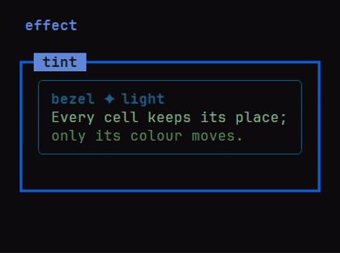

### Pulse

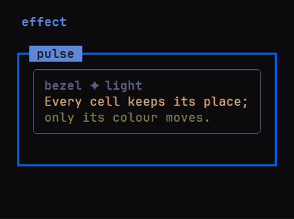

### Press

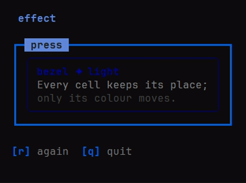

### Flash

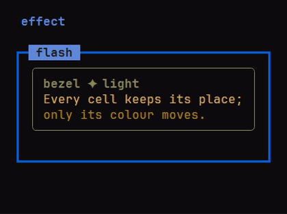

### Invert

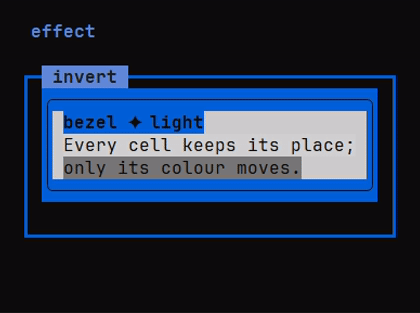

### Spotlight

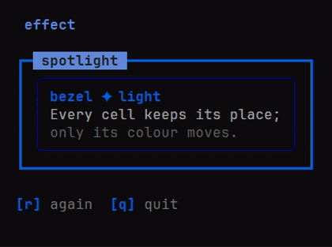

### Vignette

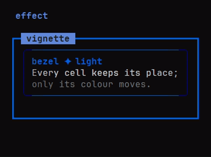

### Contrast

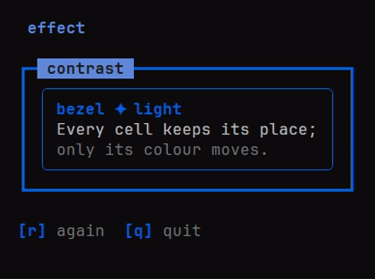

### Hover

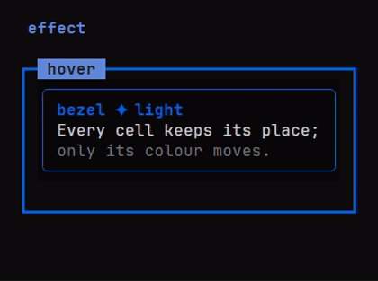

### Melt

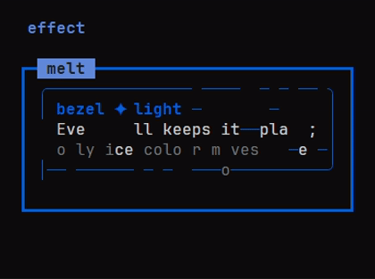

### Ripple

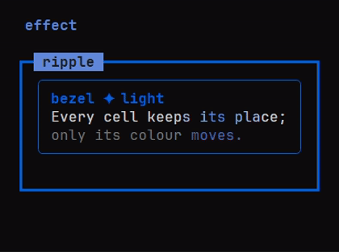

### Shine

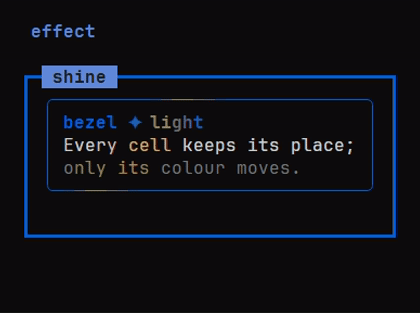

### Duotone

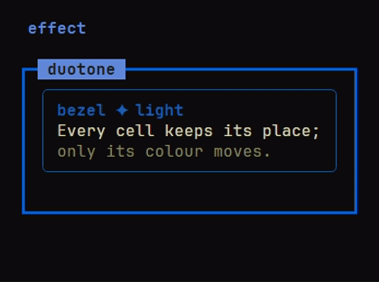

### Enter

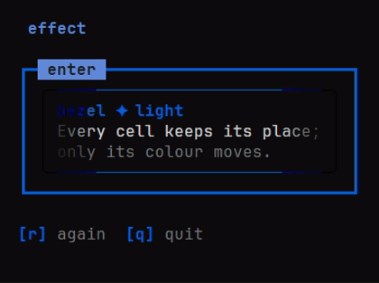

### Exit

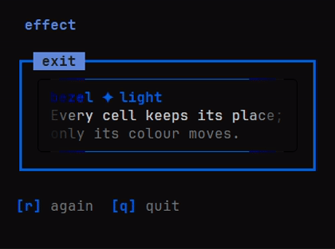

### Attention

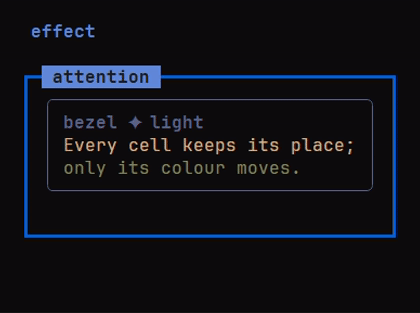

### Success

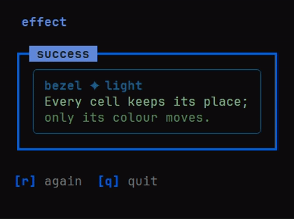

### Failure

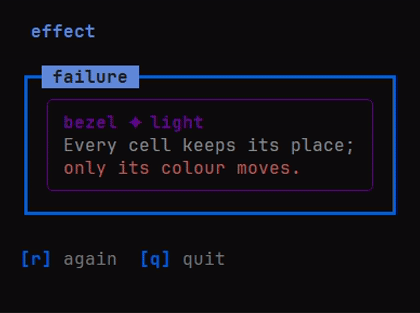

### A diff

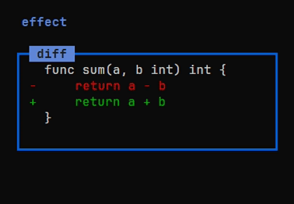

## Old screens and loading

| Effect | What it does |
| --- | --- |
| `Glitch` | tears the block for a moment: rows jump sideways and their colours split, then it comes back whole |
| `PowerOff`, `PowerOn` | turns the block off like an old tube, squashed to a line, the line to a dot; or on, the other way |
| `Scanlines` | darkens every other row, as the lines of an old screen |
| `Pixelate` | coarsens the block into squares of colour, coarsest halfway, and sharpens it again |
| `IrisIn`, `IrisOut` | opens the block out of a point in its middle, or closes it down to one |
| `Skeleton` | grey bars where the text is, a glow sweeping over them: the shape of what is still loading |
| `Trace` | a light running round the block's edge with a fading tail: a panel at work |
| `Decode` | columns of glyphs fall down the block and leave its own text behind |
| `Flicker` | the block's light stutters now and then, as a failing tube |
| `Warp` | the rows sway sideways along a travelling wave and lie straight again |
| `Marching` | dashes march round the block's edge: a selection still held |
| `Pour` | the block fills from the bottom up behind a rippling surface |

### Glitch

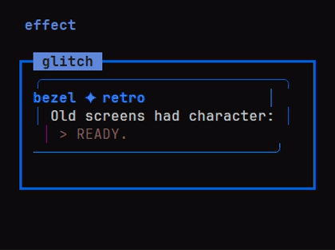

### PowerOff

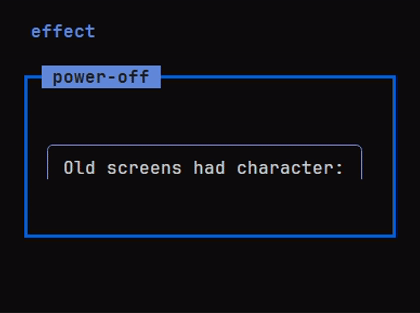

### PowerOn

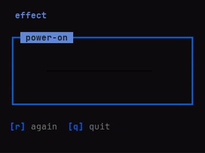

### Scanlines

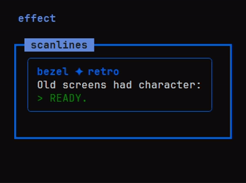

### Pixelate

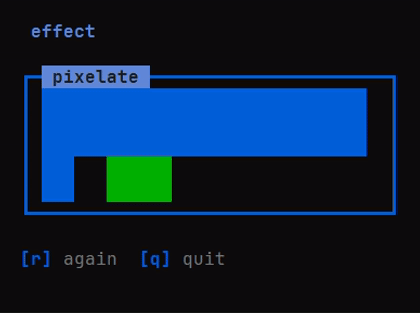

### IrisIn

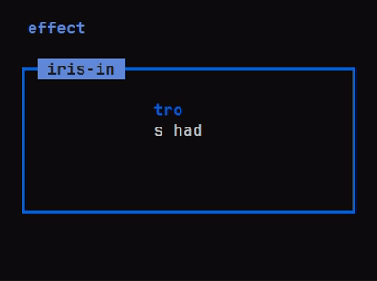

### IrisOut

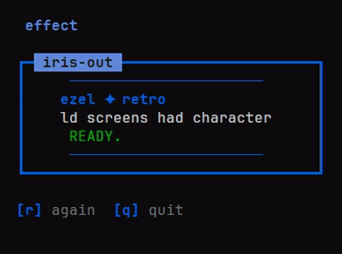

### Skeleton

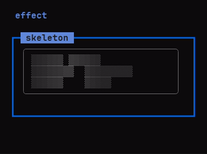

### Trace

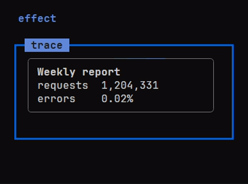

### Decode

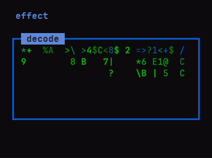

### Flicker

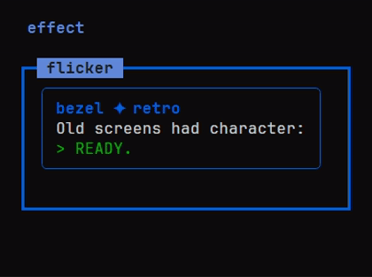

### Warp

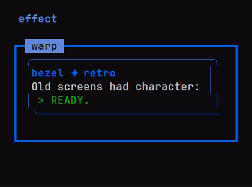

### Marching

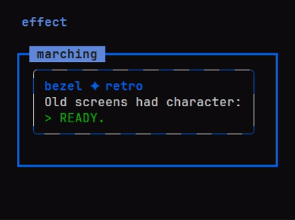

### Pour

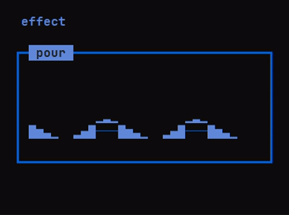

`Skeleton`, `Trace`, `Flicker` and `Marching` run until the app stops applying them. Keep a skeleton to the rows that hold text with `Within`, so the panel's border stays a border.

## From one block to the next

A `Transition` carries the screen from one block to another: `Apply(from, to)` every frame, the smaller one padded to the larger's size.

| Transition | What it does |
| --- | --- |
| `Push` | the new block pushes the old one out ahead of it |
| `Cover`, `Reveal` | the new one slides over the old, or the old slides away from over the new |
| `CrossFade` | the colours blend, the text changing over halfway |
| `Wipe` | each cell turns over in a `Pattern`'s order |
| `Zoom` | the new block grows out of the old one's middle |
| `Shuffle` | the old cells scatter, the new ones gather out of the scatter |
| `Iris` | the old block closes down to a point and the new one opens out of it |
| `Blinds` | the screen turns over in slats, every row of a slat flipping at once |
| `Stack` | the new block slides over the old, which sinks into the dark beneath it |
| `Doors`, `Shut` | the old block parts down its middle like a lift's doors, or the new one closes over it from both sides |
| `Comb` | the new block slides in row by row, every other row from the other side |
| `Turn` | the screen turns over like a card, the old block narrowing to its middle and the new one widening out of it |
| `Cube` | the two blocks turn like the faces of a cube, each darker the more it faces away |
| `Peel` | the old block folds back from its corner, its back shaded, over the new one beneath |
| `Static` | the old block turns to the snow of a lost signal, which settles into the new one |

### Push


### Cover


### Reveal

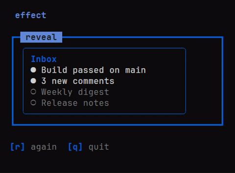

### CrossFade

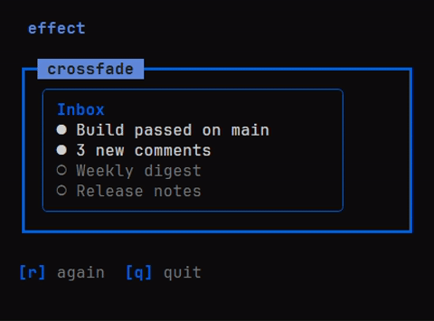

### Wipe, radial

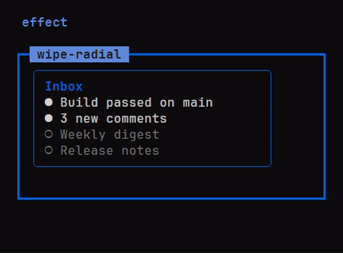

### Wipe, diagonal


### Zoom


### Shuffle


### Iris


### Blinds


### Stack


### Doors


### Shut


### Comb


### Turn


### Cube


### Peel


### Static


