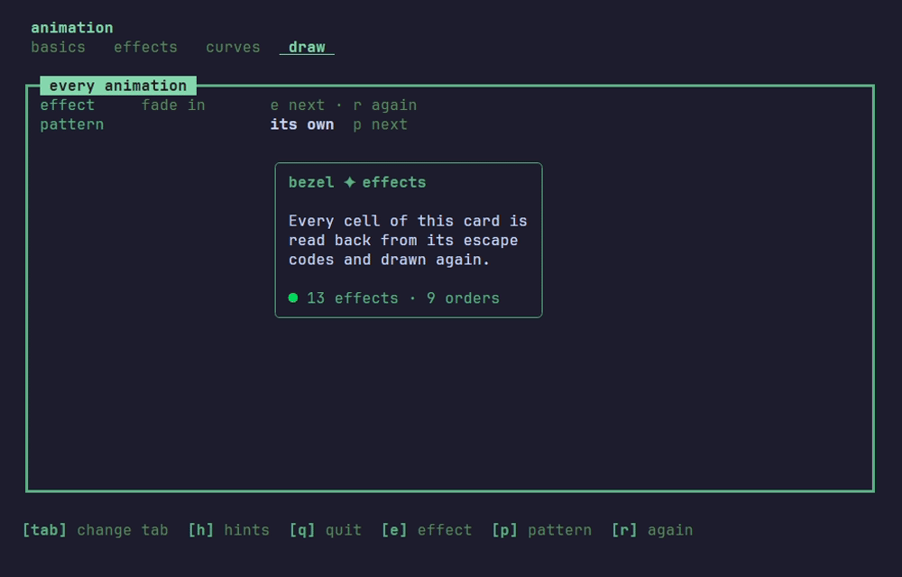
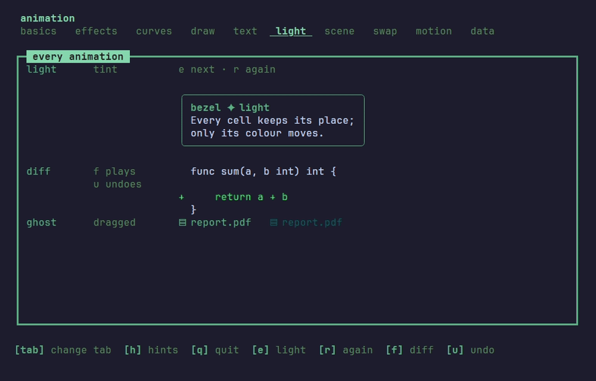
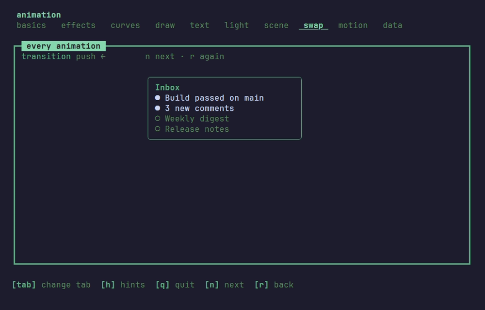

# Effects

The [`effect`](../effect) package changes a block that is already drawn.

## Over a drawn block



`Apply` reads the block's escape codes back into cells, turns each one and draws it again, the same size, so it works on whatever a `View` returns, a pane, a dialog or a whole screen:

```go
body := m.card.View()
if m.reveal.Active() {
	body = m.reveal.Apply(body)
}
```

| Effect | What it does |
|---|---|
| `FadeIn`, `FadeOut` | raises every cell's colours from a colour to its own, or sinks them into one |
| `Dissolve`, `Coalesce` | blanks the cells one by one, or gathers the block out of nothing |
| `SweepIn` | reveals the block behind a tinted front |
| `SlideIn`, `SlideOut` | moves the block in or out whole, from or to an edge |
| `Evolve` | grows each cell out of `░▒▓█` into its own character |
| `Explode` | throws the cells outward from the middle |
| `Expand`, `Stretch` | opens the block from its middle, or fills it from an edge in eighths of a cell |
| `HueShift`, `Saturate` | turns the colours round the wheel, or drains or deepens them |

Most take a `Pattern`, the order the cells turn in: `Sweep`, `Radial`, `Diamond`, `Diagonal`, `Checker`, `Spiral`, `Wave`, `Noise`, or any of them `Inverted`. The cells turn in a soft band, so a front reads as a front.

```go
effect.Coalesce(600 * time.Millisecond).WithPattern(effect.Radial())
```

`Within(x, y, w, h)` keeps an effect to a part of the block, and `OnRows(rows...)` to whole rows, each turning as a block of its own; `Reverse()` plays an effect backwards, so one that brings a block in takes it away. Every effect takes the [curves](ANIMATIONS.md#curves) and the delay, repeat and yoyo options of the motion kinds.

## Light



Lights are effects that change colour and leave every cell in its place:

| Light | What it does |
|---|---|
| `Tint`, `Pulse` | washes the block towards a colour and back, once or over and over |
| `Flash` | lights the block at once and lets the light fade: a value that changed |
| `Press` | darkens it and lets it come back, as a key pressed down |
| `Invert` | swaps text and background for a moment |
| `Spotlight`, `Vignette` | dims all but a part, or the edges more than the middle |
| `Contrast` | sharpens the colours or washes them out |
| `Hover` | brings the background to a colour and holds it; `Reverse` lets go |
| `Melt` | lets the cells drip out of the block, tinted as they fall |

The presets name what the app means rather than how it looks: `Enter`, `Exit`, `Attention`, `Success` and `Failure`. A screen asks for `effect.Attention(accent)` and gets two pulses.

On the light tab a diff plays with `Melt(red).OnRows(1)` over the removed line and `Flash(green).OnRows(2)` over the added one, and undo lights the line it brought back. `Ghost(block, bg, alpha)` fades a block towards the background, the copy that follows a drag.

## From one block to the next



A `Transition` carries the screen from one block to another: `Apply(from, to)` every frame, the smaller one padded to the larger's size.

| Transition | What it does |
|---|---|
| `Push` | the new block pushes the old one out ahead of it |
| `Cover`, `Reveal` | the new one slides over the old, or the old slides away from over the new |
| `CrossFade` | the colours blend, the text changing over halfway |
| `Wipe` | each cell turns over in a `Pattern`'s order |
| `Zoom` | the new block grows out of the old one's middle |
| `Shuffle` | the old cells scatter, the new ones gather out of the scatter |

## Between tabs

The shell plays an effect over the panes when the user changes tab, the tab strip and the legend left still. `SlideTabs` slides the new tab in from its side, and any other effect will do:

```go
shell.Config{
	// ...
	Transition: shell.SlideTabs(300 * time.Millisecond),
}
```

The shell takes the transition's frames itself and hands every other one to the app.
