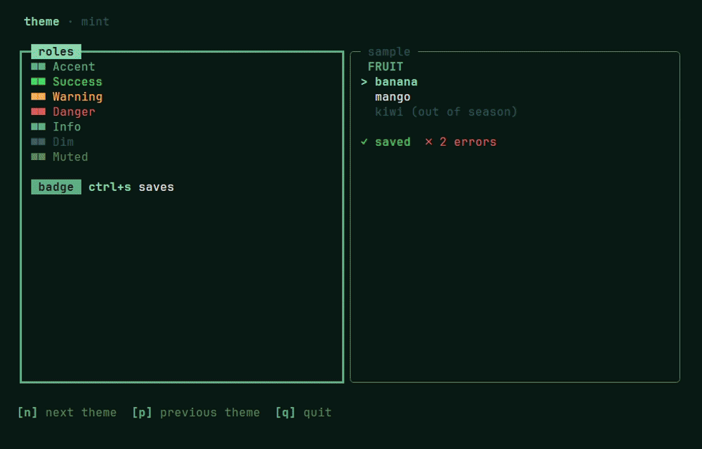
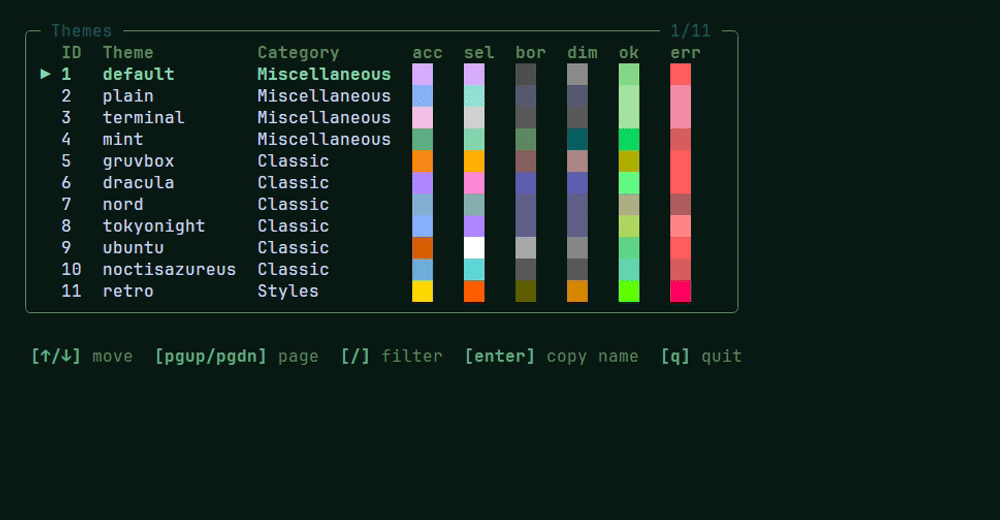

# Theme

Every colour bezel draws comes from one place, the [`theme`](../theme) package. Pick a theme, resolve it for the terminal, and hand the result to the shell and your components. Switch the theme and the whole app changes with it: borders, lists, dialogs, the legend and your own text.



```sh
go run ./examples/frame/theme   # n and p step through the presets
```

In code it's three lines:

```go
th := theme.Resolve(theme.Mint(), true) // a preset, for a dark terminal
sh := shell.New(shell.Config{Theme: th /* ... */})
body := items.View(th)                  // a component draws with the theme it is given
```

## Roles, not colours

A theme names what a colour is *for*. `theme.Colors` has one field per role:

| Role | What it colours |
| --- | --- |
| `Background` | the whole screen, behind every pane; empty keeps the terminal's |
| `Accent` | focused borders, section headings, legend keys |
| `Selection` | the cursor row, the focused panel's title |
| `Border` | unfocused borders, status and hint text |
| `Dim` | secondary text, items not yet present |
| `Text` | body text |
| `Success`, `Warning`, `Danger`, `Info` | what a thing reports: healthy, a draft, an error, a count |
| `OnAccent` | text drawn on a filled accent, success, warning or danger |
| `Series` | six colours that tell things of one kind apart, as a dashboard's panels |
| `Ramp` | three colours that climb from low to high, as a meter fills |

Each value is a lipgloss colour string: a hex value (`"#7C3AED"`) or an ANSI code (`"63"`). An empty one falls back, so a theme sets only what it means to change: one that sets `Accent` alone also gets it for `Selection` and `Info`, and one without a `Ramp` climbs through its own state colours.

## Presets

bezel ships sixteen presets. Each is a function that builds a fresh `Theme`, so one app can't change a preset for another.

| Name | Group | How it looks |
| --- | --- | --- |
| `default` | Miscellaneous | no colours of its own: follows the terminal, light or dark |
| `plain` | Miscellaneous | only the 16 ANSI colours, for terminals with few |
| `terminal` | Miscellaneous | the terminal's own palette, so the app matches the user's scheme |
| `mint` | Miscellaneous | a green accent on a dark green background |
| `gruvbox` | Classic | warm orange and yellow on dark brown |
| `dracula` | Classic | purple and pink on blue-grey |
| `nord` | Classic | frost blues on polar night |
| `tokyonight` | Classic | neon blues on deep indigo |
| `ubuntu` | Classic | Ubuntu orange on aubergine |
| `noctisazureus` | Classic | sky blue and sea green on deep navy |
| `catppuccin` | Classic | Catppuccin Mocha: mauve and pastels |
| `rosepine` | Classic | rose and iris on a dusky base |
| `retro` | Styles | an amber CRT |
| `minimal` | Styles | white on near-black, colour only for state |
| `cyberpunk` | Styles | cyan and magenta on blue-black |
| `ocean` | Styles | sky blue and sea foam on deep water |

`default`, `plain` and `terminal` keep the terminal's background. Every other preset paints its own, so it looks the same whatever the terminal's colours are.

Four of them have a function of their own (`theme.Default()`, `Plain()`, `Terminal()`, `Mint()`). Every one can be found by name: `theme.Lookup(name)` takes any case and gives `Default` for an empty name, and `theme.All()` and `theme.Categories()` list them all. That's what a `--theme` flag needs.

### Browsing them

[`themebrowser`](../component/themebrowser) shows every preset in a table with its colours, so users can pick one. It's what a `--list-themes` flag prints:



```go
if listThemes {
	return themebrowser.BrowseInTerminal(theme.Default()) // a table in a terminal, plain lines in a pipe
}
t, err := theme.Lookup(flagTheme)
```

In a terminal the table fits the width, `/` filters it and `enter` copies a theme's name. Piped into a file or another command, it prints the names instead, one line per group. Try it with `go run ./examples/component/themebrowser`.

## A theme of your own

A `Theme` layers: `Base` points at the theme under it, and every role it sets overrides that one. A preset is a base to build on:

```go
mint := theme.Mint()
brand := theme.Theme{
	Base:   &mint,
	Colors: theme.Colors{Accent: "#FF5F87", Danger: "#D7005F"},
}
```

Everything not set comes from `Mint`, and what `Mint` leaves empty from the adaptive default. A `Base` may have a `Base` of its own, so a company theme and a product's tweak of it are two layers.

## Light and dark

`theme.Resolve(t, dark)` turns a theme into the styles everything draws with, for a dark or a light background. The terminal says which: ask in `Init`, and resolve again when it answers.

```go
func (m model) Init() tea.Cmd { return tea.RequestBackgroundColor }

func (m model) Update(msg tea.Msg) (tea.Model, tea.Cmd) {
	if bg, ok := msg.(tea.BackgroundColorMsg); ok {
		m.th = theme.Resolve(m.theme, bg.IsDark())
		m.sh = m.sh.SetTheme(m.th)
	}
	// ...
}
```

The answer can come after the first frame, so the app starts from a guess, usually dark, and switches once. Code that resolves a theme outside a running program, a `--list-themes` or a plain CLI, asks with `theme.DarkTerminal()`.

## The background

A theme with a `Background` colours the whole screen, not just the text. `Resolved.Background` is that colour and `Resolved.Foreground` is its `Text`; both are nil when the theme has no background.

With the shell you don't have to do anything: `Shell.View` returns a `tea.View` with both colours set. Without the shell, set them yourself:

```go
v := tea.NewView(content)
v.BackgroundColor, v.ForegroundColor = m.th.Background, m.th.Foreground
```

Bubble Tea changes the terminal's colours while the program runs and puts them back when it quits, so the gaps between styled text get the colour too. A terminal that can't do this keeps its own colours, and nothing breaks.

A theme with a background also decides light or dark by itself: `Resolve` ignores the `dark` argument. So a light theme on a dark terminal still gets dark text. Programs that print into the terminal instead of taking it over, like `inline` and `logger`, never touch the background.

## Drawing with it

`theme.Resolved` holds the colours it came from and a lipgloss style for each use:

- text that says what it is: `Success`, `Warning`, `Danger`, `Info`, `Accent`, `Dim`, `Muted`, `Bold`, `Key`;
- lists and tables: `Section`, `TableHeader`, `Cursor`, `Badge`, and `Match` and `MatchCurrent` for search hits;
- the frame's own: `Panel`, `PanelFocused`, `Chrome`, `Legend`, `StatusOK`, `StatusErr`, `Modal`, `Button`;
- `Series` and `Ramp`, the colours of the same name as foreground styles.

An app draws its pane bodies with these, so a theme switch recolours the app's text along with bezel's:

```go
func (m model) detail(r layout.Rect) string {
	return m.th.Dim.Render("modified ") + m.th.Info.Render(m.when)
}
```

`CaretBlink` is how fast every text field built with the theme blinks its caret; a test shrinks it there.

## Where the theme goes

Who calls `View` decides where a component takes its theme, and [CONVENTIONS.md](CONVENTIONS.md#the-theme) has the full table:

- the shell, from `Config.Theme`, replaced with `SetTheme` and read back with `Theme()`;
- a component the app draws, in `View(th, ...)`, so one model draws under any theme;
- a dialog, which bezel draws, as its constructor's last argument;
- a form, as `form.New(th, fields...)`, which paints every control in it;
- a plain function, such as a progress bar or a chart, after the data it draws.

## What follows the theme

Almost everything follows the theme, and most components also accept a `WithStyles` edit. Plain functions like `chart.Bars` or `progress.Bar` follow the theme but take no edit. A few things ignore the theme on purpose:

- **Alerts, dialog tints and toasts.** Blue, green, yellow and red tell the user what happened, so these colours stay fixed whatever the theme.
- **Animations, scenes and effects.** Their colours are arguments. Usually the app reads them from the theme, as in `th.Accent.GetForeground()`.
- **`themebrowser`.** It shows every theme, so it can't be painted by one.

[CONVENTIONS.md](CONVENTIONS.md#styles) says which group each package is in.

## One component, recoloured

Where one component should look different from the theme, without a new theme for everything, its `WithStyles` edits the styles derived from the theme:

```go
sp := spinner.New(spinner.Dot()).WithStyles(func(s spinner.Styles) spinner.Styles {
	s.Frame = s.Frame.Foreground(lipgloss.Color("#FF5F87"))
	return s
})
```

The edit is kept, not the result: it applies again on every theme, so the spinner stays pink through a switch from light to dark. `DefaultStyles(th)` is what the edit starts from.
